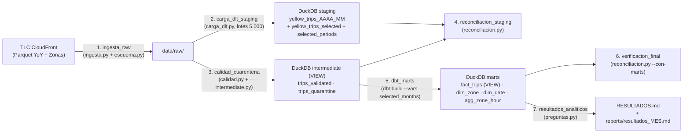
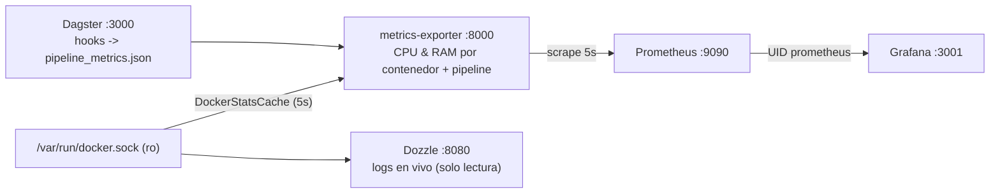

# Pipeline Batch NYC Taxi — Arquitectura Dinámica (`make all MES=AAAA-MM`)

Plataforma reproducible e idempotente de ingeniería de datos para ingerir, validar, limpiar y modelar los viajes de taxi amarillo de Nueva York de **cualquier período mensual `MES=AAAA-MM`** junto con su **mismo mes del año anterior `(AAAA-1)-MM`** y el catálogo oficial de **265 zonas** de la NYC TLC, bajo una **única arquitectura oficial** orquestada por Dagster sobre `data/warehouse/nyc_taxi_dlt.duckdb`, con transformaciones dinámicas en `dbt` y observabilidad real por contenedor Docker en Prometheus, Grafana y Dozzle.

Ver también el resumen técnico en [`docs/ARQUITECTURA_FINAL.md`](docs/ARQUITECTURA_FINAL.md) y los resultados analíticos del último período ejecutado en [`RESULTADOS.md`](RESULTADOS.md) (con copias históricas en `reports/resultados_<MES>.md`).

---

## 1. Arquitectura definitiva y flujo único oficial





### Responsabilidad única por herramienta

| Herramienta | Propiedad en el sistema |
|---|---|
| **Python 3.12 + PyArrow** | Descarga streaming SHA-256 idempotente, validación contra contrato YAML, streaming por lotes y exporter HTTP. |
| **dlt 1.32.0** | Ingesta idempotente por lotes Arrow de 5.000 filas hacia `staging.yellow_trips_AAAA_MM` (conservando históricos) y consolidación atómica en `staging.yellow_trips_selected` + `staging.selected_periods`. |
| **DuckDB 1.5.6** | Motor analítico columnar único (`data/warehouse/nyc_taxi_dlt.duckdb`) con límites de memoria acotados (`1GB` en `dbt`, `768MB` en `dlt`, `1.2GB` en `calidad`), `threads=2` y volcado a disco (`data/tmp/duckdb`). |
| **Calidad (`src/calidad.py` + `src/intermediate.py`)** | Evaluación SQL de las 11 reglas (`R01`–`R11`) de `contracts/quality_rules.yaml`, particiones Parquet `validada/` y `quarantine/`, y vistas transaccionales en `intermediate`. |
| **dbt 1.12 / dbt-duckdb** | Capas `dbt_staging` → `intermediate` → `marts` (`fact_trips` como `VIEW`, `dim_zone`, `dim_date`, `agg_zone_hour`) sin nombres de meses fijos (`57` nodos en `dbt build`: `8` modelos + `49` pruebas automatizadas). |
| **Dagster 1.13 (`orchestration/`)** | Único orquestador oficial (`nyc_taxi_pipeline`, 7 *Software-Defined Assets* en serie), invocado tanto desde Dagster UI/GraphQL como desde `orchestration/cli.py` y `make all`. |
| **Docker & Compose** | Empaquetado y red local de los 5 servicios esenciales (`dagster-webserver`, `metrics-exporter`, `prometheus`, `grafana`, `dozzle`) con puertos acotados a `127.0.0.1`. |
| **Prometheus + Exporter** | Recolección cada `5 s` de métricas de negocio del pipeline y consumo real individual de CPU/RAM por contenedor Docker. |
| **Grafana** | Dashboard provisionado `NYC Taxi — Pipeline Monitoring` con 12 paneles en vivo. |
| **Dozzle** | Visor web de logs en tiempo real conectado al socket Docker en modo solo lectura (`DOZZLE_ENABLE_ACTIONS=false`). |

---

## 2. Ejecución rápida dinámica (`make all MES=AAAA-MM`)

El único parámetro requerido es `MES` en formato `AAAA-MM`. Automáticamente calcula `mes_comparacion = (AAAA-1)-MM`:

```powershell
# Período principal enero 2025 (procesa 2024-01 y 2025-01 automáticamente)
make all MES=2025-01

# Otros ejemplos dinámicos (si los datos oficiales publicados cumplen el contrato)
make all MES=2025-03
make all MES=2025-06
make all MES=2026-01

# Reutilizar Parquets ya descargados sin consultar HTTP (modo offline)
make all MES=2025-03 SIN_INGESTA=1

# Forzar recarga completa en dlt aunque las filas ya coincidan
make all MES=2025-01 FORZAR_DLT=1
```

También se puede invocar el adaptador CLI directamente (llama internamente a `nyc_taxi_pipeline`):

```powershell
.\.venv\Scripts\python.exe -m orchestration.cli --mes 2025-01
.\.venv\Scripts\python.exe -m orchestration.cli --mes 2025-03 --sin-ingesta
```

> **Nota sobre interpretaciones de negocio:** `docs/interpretaciones.yaml` se aplica únicamente al par base (`2024-03`, `2025-03`). Para cualquier otro período (`2025-01`, `2025-06`, etc.), `src/preguntas.py` genera el título dinámico correspondiente (`Enero 2025 vs Enero 2024`), ejecuta las 6 consultas SQL con los filtros del período y muestra `(interpretación pendiente para este período)` para no mezclar texto específico de marzo.

---

## 3. Cifras reales verificadas en ejecución end-to-end

Conmutando dinámicamente `Marzo → Enero → Marzo`, `staging` conserva en DuckDB todos los meses históricos ya cargados mientras `staging.yellow_trips_selected`, `intermediate.*`, `marts.*` y `RESULTADOS.md` reflejan exclusivamente el período activo:

### Período base `MES=2025-03` (`2024-03` vs `2025-03`)

| Período | `staging` (`dlt`) | `aceptadas` (`intermediate`) | `cuarentena` (`intermediate`) | Diferencia |
|---|---:|---:|---:|---:|
| `2024-03` | 3.582.628 | 3.453.562 | 129.066 | 0 |
| `2025-03` | 4.145.257 | 3.955.293 | 189.964 | 0 |
| **TOTAL** | **7.727.885** | **7.408.855** | **319.030** | **0** |

- **Marts:** `marts.fact_trips = 7.408.855`, `marts.dim_zone = 265`, `marts.dim_date = 396`, `marts.agg_zone_hour = 205.179` (`7.408.855` viajes, revenue `203.263.790,71 USD`).

### Período alternativo real `MES=2025-01` (`2024-01` vs `2025-01`)

| Período | `staging` (`dlt`) | `aceptadas` (`intermediate`) | `cuarentena` (`intermediate`) | Diferencia |
|---|---:|---:|---:|---:|
| `2024-01` | 2.964.624 | 2.870.976 | 93.648 | 0 |
| `2025-01` | 3.475.226 | 3.323.516 | 151.710 | 0 |
| **TOTAL** | **6.439.850** | **6.194.492** | **245.358** | **0** |

- **Marts:** `marts.fact_trips = 6.194.492`, `marts.dim_zone = 265`, `marts.dim_date = 397`, `marts.agg_zone_hour = 167.318` (`6.194.492` viajes, revenue `165.896.143,17 USD`).

---

## 4. Instalación y arranque con Docker Compose

Requisitos: Python 3.12, GNU Make (opcional para usar `make all`), Git, Docker Desktop y ~2,5–3 GB libres para datos/imágenes.

```powershell
# 1. Clonar y crear entorno virtual local
git clone https://github.com/nicoquinteros23/pipeline-nyc-taxi.git
cd pipeline-nyc-taxi
python -m venv .venv
.\.venv\Scripts\Activate.ps1
pip install -r requirements.txt

# 2. Construir imagen (solo la primera vez) e iniciar los 5 servicios Docker
docker compose build
docker compose up -d dagster-webserver metrics-exporter prometheus grafana dozzle

# 3. Verificar que todos estén healthy
docker compose ps
```

*(Con `make` disponible: `make install`, `make up`, `make ps`, `make down`).*

### Puertos locales verificados (solo `127.0.0.1`)

| Servicio | Contenedor | URL local | Credenciales / Notas |
|---|---|---|---|
| Dagster UI | `nyc-taxi-dagster` | `http://127.0.0.1:3000` | Job `nyc_taxi_pipeline` (7 assets, config `TaxiPipelineConfig`) |
| Metrics Exporter | `nyc-taxi-exporter` | `http://127.0.0.1:8000/metrics` | Salud en `/health` |
| Prometheus | `nyc-taxi-prometheus` | `http://127.0.0.1:9090` | Targets `prometheus` y `nyc_taxi_exporter` |
| Grafana | `nyc-taxi-grafana` | `http://127.0.0.1:3001` | `admin` / `admin` (`GRAFANA_ADMIN_*`) |
| Dozzle | `nyc-taxi-dozzle` | `http://127.0.0.1:8080` | Solo lectura (`/var/run/docker.sock:ro`) |

---

## 5. Otros comandos de verificación, dbt y tests

```powershell
# Ejecutar desde Dagster UI (http://127.0.0.1:3000): Jobs -> nyc_taxi_pipeline -> Launchpad -> configurar `mes` y presionar Launch Run
# O mediante make (equivalente CLI sin red):
make dagster-run MES=2025-03

# Verificar datos, dbt y consultas analíticas para un período activo:
.\.venv\Scripts\python.exe -m src.reconciliacion --mes 2025-03 --con-marts
.\.venv\Scripts\dbt.exe build --project-dir dbt_project --profiles-dir dbt_project --vars "{\"selected_months\": [\"2024-03\", \"2025-03\"]}"
.\.venv\Scripts\python.exe -m src.preguntas --mes 2025-03 --copia-periodo reports/resultados_2025-03.md

# Suite automatizada completa (unitarias + integración sintética 2025-06 vs 2026-06 + concurrencia):
.\.venv\Scripts\python.exe -m pytest -v

# Detener los servicios Docker conservando datos y volúmenes:
docker compose down
```

---

## 6. Observabilidad: Grafana, Prometheus y Dozzle

- **Grafana (`http://127.0.0.1:3001`, usuario `admin` / clave `admin`):** abrir **Dashboards → NYC Taxi → `NYC Taxi — Pipeline Monitoring`**.
- **Cómo interpretar CPU y RAM por contenedor:**
  - `metrics-exporter` consulta `/var/run/docker.sock` (`DockerStatsCache`, cada `5 s`) para cada servicio Compose del proyecto.
  - **CPU (`nyc_taxi_container_cpu_percent`):** calculado mediante delta de `cpu_stats` / `system_cpu_usage × online_cpus × 100`.
  - **RAM (`nyc_taxi_container_memory_usage_bytes`):** reporta `memory_stats.usage - inactive_file` en bytes (equivalente a `docker stats`, mostrado en MiB por Grafana).
- **Prometheus (`http://127.0.0.1:9090`):** verificar **Status → Targets** (`prometheus` y `nyc_taxi_exporter` en `UP`). Ejemplos PromQL: `nyc_taxi_container_cpu_percent`, `nyc_taxi_container_memory_usage_bytes`, `nyc_taxi_container_running`, `nyc_taxi_reconciliation_diff_rows`, `nyc_taxi_pipeline_stage_duration_seconds`.
- **Dozzle (`http://127.0.0.1:8080`):** seleccionar **`nyc-taxi-dagster`** para seguir en vivo los logs de cada asset del pipeline, `dlt` y `dbt build`.

---

## 7. Estructura del repositorio

```text
contracts/          yellow_schema.yaml (20 columnas) y quality_rules.yaml (R01–R11)
src/                ingesta.py, esquema.py, carga_dlt.py, calidad.py, intermediate.py,
                    reconciliacion.py, preguntas.py, metrics_exporter.py
orchestration/      definitions.py, assets.py (7 assets), jobs.py, resources.py, cli.py, dagster.yaml
dbt_project/        dbt_project.yml, profiles.yml, macros/, models/{staging,intermediate,marts}, tests/
monitoring/         prometheus/prometheus.yml y grafana/{provisioning,dashboards/nyc_taxi_monitoring.json}
reports/            Calidad JSON/MD por mes, pipeline_metrics.json y copias resultados_<MES>.md
sql/                q1_top_zonas.sql .. q6_variacion.sql
tests/              Suite pytest (46 tests incluyendo pipeline dinámico sintético 2025-06/2026-06)
docs/               ARQUITECTURA_FINAL.md, exploracion.md, interpretaciones.yaml
Dockerfile          docker-compose.yml  Makefile  requirements.txt  RESULTADOS.md
```

---

## 8. Seguridad, concurrencia y limitaciones conocidas

- **Concurrencia:** solo puede correr **una ejecución pesada a la vez**. `orchestration/resources.py` bloquea a nivel de ejecución completa mediante `data/tmp/pipeline_run.lock` (`adquirir_lock_ejecucion` / `liberar_lock_ejecucion` en hooks y `finally`), valida runs activos en Dagster (`verificar_sin_otra_ejecucion_activa`) y serializa escrituras puntuales con `data/tmp/pipeline_duckdb.lock` (`in_process_executor` + `DefaultRunCoordinator`).
- **Seguridad Docker:** todos los puertos escuchan en `127.0.0.1`. `/var/run/docker.sock` se monta en `:ro` únicamente en `metrics-exporter` y `dozzle` (`DOZZLE_ENABLE_ACTIONS=false`).
- **Disponibilidad TLC y hardware:** los ejemplos futuros (como `2026-01` o `2026-10`) dependen de que los Parquet oficiales correspondan a meses ya publicados por NYC TLC y respeten `contracts/yellow_schema.yaml`. En equipos con 8 GB de RAM, evitar ejecutar corridas locales simultáneas con Docker Desktop cargado al límite de memoria virtual de Windows; usar `SIN_INGESTA=1` cuando se quiera trabajar sin acceso a red. `data/warehouse/taxi.duckdb` se conserva intacta sin dependencias activas. En marzo 2025, `VendorID = 7` (`21.481` filas) entra en cuarentena por `R02` (`bajada <= subida`) y `passenger_count = NULL` coincide 1:1 con `payment_type = 0` (`R06` marcada como advertencia).

## Visualizar la ejecución en Dagster UI

1. **Iniciar Docker Desktop**
   - Abra Docker Desktop manualmente (doble clic en el acceso directo) antes de cualquier comando. Mantenga la aplicación abierta; no la cierre al terminar la ejecución del pipeline.
2. **Arrancar los servicios**
   ```powershell
   docker compose up -d dagster-webserver metrics-exporter prometheus grafana dozzle
   ```
   - El contenedor `nyc-taxi-dagster` expone la UI en el puerto **3000**.
3. **Ejecutar el pipeline**
   ```powershell
   make dagster-run MES=2025-07
   ```
   - La ejecución se registra en la base interna de Dagster.
4. **Abrir la UI**
   - En su navegador, visite `http://127.0.0.1:3000`.
   - Navegue a **Jobs → nyc_taxi_pipeline**.
   - Verá la lista de ejecuciones recientes; haga clic en el ID (por ejemplo `15195d39‑3d0c‑4b36‑83ee‑e3770a7fbd14`) para inspeccionar los pasos y logs.
5. **Problemas comunes**
   - Si la UI no muestra la corrida, es probable que el contenedor `nyc-taxi-dagster` se haya detenido porque Docker Desktop se cerró al final del comando `make`. Asegúrese de que Docker Desktop siga activo o inicie el contenedor por separado antes de lanzar el pipeline.
   - Use `docker compose ps` para confirmar que el contenedor está `healthy`.
   - Puede verificar los logs con `docker logs nyc-taxi-dagster` si necesita más detalles.

**Consejo:** Añada este paso al README bajo la sección "Instalación y arranque con Docker Compose" para que futuros usuarios sepan cómo visualizar las corridas.
