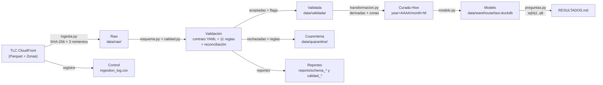
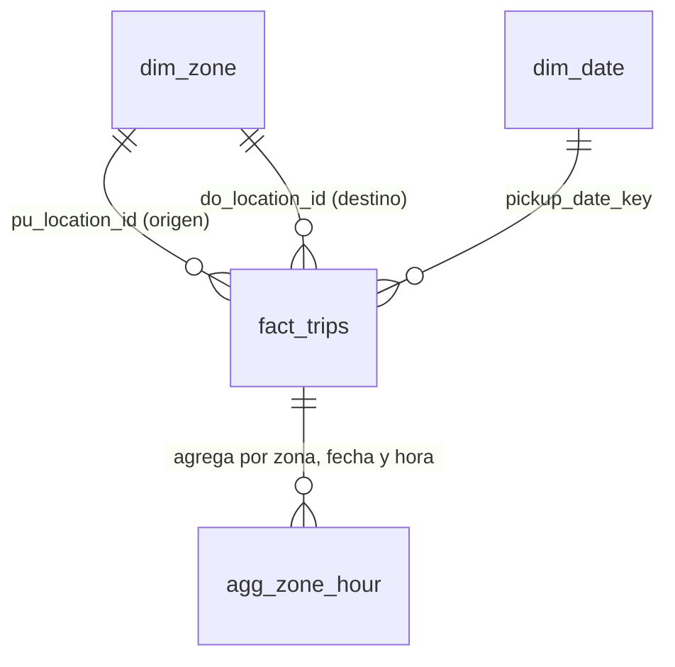
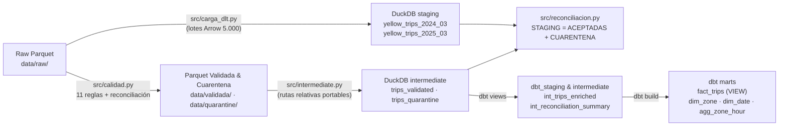
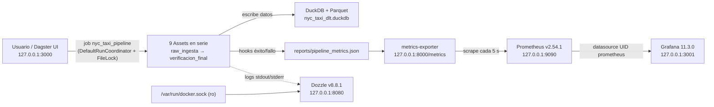

# Pipeline batch NYC Taxi (taxi amarillo)

Pipeline reproducible que ingiere, valida, limpia y modela los viajes de taxi amarillo de Nueva York
de dos meses: el mes asignado (**2025-03**) y el mismo mes de 2024 (**2024-03**), junto con la tabla de
zonas de la TLC. Responde seis preguntas de negocio con SQL sobre el modelo (ver `RESULTADOS.md`).

Stack: Python 3.10 o superior (probado con 3.12.10), DuckDB 1.5.6, dlt 1.32.0, dbt-core 1.12.7, dbt-duckdb 1.11.1, Dagster 1.13.31, prometheus-client 0.26.0, PyArrow 26.0.1, PyYAML, requests, psutil, pytest, Prometheus, Grafana, Dozzle y Docker Compose.

## 1. Cómo instalar y ejecutar

Requisitos: Python 3.10+, Git y conexión a internet la primera vez (se descargan los archivos de la TLC, unas decenas de MB por mes).

```bash
git clone https://github.com/nicoquinteros23/pipeline-nyc-taxi.git
cd pipeline-nyc-taxi
python -m venv .venv
source .venv/bin/activate          # Windows PowerShell: .\.venv\Scripts\Activate.ps1
pip install -r requirements.txt
```

Comando único (ingesta, esquema, calidad, transformación, modelo y preguntas, para el mes asignado
y su mes de comparación, que es el mismo mes del año anterior):

```bash
make all MES=2025-03
```

Si `make` no está disponible, el equivalente directo es:

```bash
python -m src.pipeline --mes 2025-03
```

Otros comandos:

| Comando | Qué hace |
|---|---|
| `make all MES=2025-03` | Ejecuta el pipeline original (Fase 1) completo |
| `make fase2 MES=2025-03` | Ejecuta el pipeline completo de Fase 2 (`dlt` + calidad + `intermediate` + `dbt build` + reconciliación) |
| `make intermediate` | Reconstruye de forma idempotente las vistas `intermediate` sobre Parquet validados/cuarentena |
| `make reconciliar` | Verifica `staging = aceptadas + cuarentena` y cierre con `marts` de dbt |
| `make dbt-build` | Ejecuta modelos y tests de dbt (`staging`, `intermediate`, `marts`) |
| `make dbt-test` | Ejecuta únicamente los 50 tests de dbt |
| `make up` | Levanta los 5 servicios de Fase 3 en Docker Compose (Dagster, Exporter, Prometheus, Grafana y Dozzle) |
| `make down` | Detiene los contenedores de Docker Compose |
| `make ps` | Muestra el estado y salud de los contenedores |
| `make dagster-run MES=2025-03` | Ejecuta en proceso el job `nyc_taxi_pipeline` de Dagster |
| `make test` | Corre los **54 tests** automatizados (`pytest`: Fase 1 + Fase 2 + Fase 3 + Fase 4) |
| `make demo-reproceso` | Reprocesa un mes e imprime conteos antes y después (ver sección 3.5) |
| `make clean-data` | Borra las capas derivadas y reportes (no borra `data/raw`) |
| `make clean-all` | Borra **todo** (`data/` completo incluyendo `data/raw` y `reports/`) para descargar y correr desde cero |
| `make dashboard` | Abre el dashboard analítico Streamlit en `http://127.0.0.1:8501` (`READ_ONLY` sobre `nyc_taxi_dlt.duckdb`, esquema `marts`) |

Salidas principales: `RESULTADOS.md`, `reports/` (esquema, calidad y tiempos por mes) y `data/`
(excluido de Git).

## 2. Arquitectura



| Capa | Ubicación | Contenido |
|---|---|---|
| Raw | `data/raw/yellow/year=AAAA/month=MM/` y `data/raw/zones/` | Archivos tal como se descargaron. Nunca se modifican. |
| Control | `data/control/ingestion_log.csv` | Historial de descargas: archivo, URL, filas, bytes, hash, fecha-hora y estado. |
| Validada | `data/validada/year=AAAA/month=M/` | Filas aceptadas por las reglas de calidad, con columna `flags` de advertencias. |
| Cuarentena | `data/quarantine/year=AAAA/month=M/` | Filas rechazadas, con archivo de origen, número de fila y reglas violadas. |
| Curada | `data/curated/trips/year=AAAA/month=M/` | Filas validadas más columnas derivadas y zonas. Parquet particionado estilo Hive. |
| Modelo | `data/warehouse/taxi.duckdb` | `fact_trips` (vista sobre la curada), `dim_zone`, `dim_date`, `agg_zone_hour`. |

Cada etapa es un módulo de `src/` ejecutable con `python -m src.<etapa> --mes AAAA-MM`. El runner
`src/pipeline.py` las encadena y corta en la primera que falla, indicando cuál fue y devolviendo código
de salida distinto de 0.

## 3. Decisiones

### 3.1 Herramienta: DuckDB

Cada mes tiene entre 3,5 y 4,1 millones de filas y el pipeline debe correr en 8 GB de RAM. Se eligió
DuckDB porque lee Parquet directamente desde SQL, procesa por bloques, vuelca a disco lo que no entra
(se fija `memory_limit` en 4 GB por etapa) y permite escribir el modelo y las preguntas en SQL. Con
pandas habría que cargar cada mes completo en memoria, y los duplicados y los joins agregan copias
intermedias.

### 3.2 Ingesta

- La descarga se hace por bloques a un archivo `.part` y se renombra al terminar, así un corte nunca
  deja un archivo truncado con el nombre final.
- **Idempotencia:** si el archivo existe y su SHA-256 coincide con el último hash registrado como `ok`
  en el log, no se vuelve a descargar (se registra la acción `omitido`). Si no coincide, se descarga de nuevo.
- El log solo agrega líneas: es un historial de intentos. Lo que no debe duplicarse son los datos.
- Hasta 3 reintentos (4 intentos en total) con espera creciente (2 s, 4 s, 8 s), solo para errores transitorios (fallas de red
  y HTTP 429, 500, 502, 503 y 504). Los errores permanentes fallan de inmediato. El servidor responde
  **403** (no 404) cuando un archivo no existe, por ejemplo un mes no publicado.
- Si la ingesta falla, se registra `estado=error` y el proceso termina con código 1.

### 3.3 Esquema

- El contrato `contracts/yellow_schema.yaml` (versión 1) define 20 columnas con tipo y si admiten nulos.
  Los tipos salen de la exploración de los archivos reales (por ejemplo `passenger_count`, `ratecode_id`
  y `payment_type` son BIGINT).
- Antes de cargar cada mes se compara su esquema contra el contrato y se escribe
  `reports/schema_AAAA-MM.json` con columnas faltantes, nuevas y de tipo distinto.
- Los nombres se normalizan a snake_case (`PULocationID` pasa a `pu_location_id`; `Airport_fee` conserva
  la mayúscula en ambos años y pasa a `airport_fee`).
- **`cbd_congestion_fee` en 2024 es NULL.** El cargo empezó a regir en 2025, así que en 2024 no existía.
  NULL significa "no aplica"; 0 significaría "aplicó y valió cero", lo cual sería falso. Consecuencia:
  SUM y AVG ignoran los NULL, y la pregunta 3 se calcula solo sobre el mes asignado, donde la columna no
  tiene nulos. Alternativa descartada: usar 0 simplificaría las sumas pero mezclaría "no existía" con
  "valió cero".
- **Columna nueva fuera del contrato:** se registra una advertencia en el reporte de esquema, no se carga
  a la capa curada y el archivo raw queda intacto. No se pierde información, el pipeline no se rompe por un
  cambio inofensivo y incorporarla exige un cambio versionado del contrato.
- **Columna obligatoria faltante o tipo incompatible:** el pipeline falla. Un cambio de tipo seguro
  (por ejemplo INTEGER a BIGINT) se castea con advertencia; uno que podría perder información
  (BIGINT a INTEGER) falla.
- Hallazgo: al leer los archivos desde carpetas `year=.../month=...`, DuckDB agregaba por su cuenta las
  columnas `year` y `month`. El comparador de esquema lo detectó como columnas nuevas y se desactivó
  `hive_partitioning` al validar y unificar los archivos raw.

### 3.4 Calidad de datos y cuarentena

Las reglas están en `contracts/quality_rules.yaml`, cada una con id, descripción, severidad, umbral y
justificación. Una sola pasada de SQL calcula, para cada fila, las reglas violadas. **Rechazo** envía la
fila a cuarentena; **advertencia** la deja pasar y la marca en `flags`.

Filas que violan cada regla en 2025-03 (una fila puede violar varias, por eso la suma supera a la
cuarentena):

| ID | Regla | Severidad | Umbral | Filas 2025-03 | Justificación |
|---|---|---|---|---|---|
| R01 | Subida fuera del mes del archivo | Rechazo | inicio de mes <= subida < inicio del mes siguiente | 33 | Contamina conteos y particiones por mes; la exploración encontró subidas de 2007 y 2002. |
| R02 | Bajada anterior o igual a la subida | Rechazo | bajada > subida | 22.280 | Duración no positiva es imposible y rompe duración y velocidad. |
| R03 | Distancia menor o igual a 0 | Rechazo | distancia > 0 | 103.722 | Sin distancia no hay viaje utilizable y se rompe la velocidad. |
| R04 | Distancia mayor al máximo | Rechazo | distancia <= 100 millas | 214 | El percentil 99,99 es 58 mi; entre 100 y 200 mi casi no hay viajes y el máximo llega a 320.136 mi. |
| R05 | Importe total negativo | Rechazo | total_amount >= 0 | 68.686 | Reembolsos o disputas no representan el ingreso de un viaje. |
| R06 | Pasajeros nulo o 0 | Advertencia | pasajeros >= 1 | 939.378 | Los nulos son estructurales (ver abajo). Rechazarlos descartaría viajes válidos. |
| R07 | Zona inexistente en la tabla de zonas | Rechazo | id presente en `taxi_zone_lookup` | 0 | Sin zona no se puede enriquecer ni unir al modelo. |
| R08 | Fila duplicada exacta | Rechazo | se conserva la primera ocurrencia | 0 | Duplicar infla viajes e ingresos. |
| R09 | Velocidad promedio imposible (regla propia) | Rechazo | velocidad <= 100 mph | 961 | El percentil 99,9 es 46 mph y el 99,99 supera 1.000 mph. |
| R10 | Zona Unknown, ids 264 o 265 | Advertencia | n/a | 28.415 | Existe en la tabla de zonas pero no informa ubicación; se conserva y se marca. |
| R11 | Importe total excesivo (regla propia) | Rechazo | total_amount <= 1.000 USD | 17 | El percentil 99,99 es 326 USD y el máximo llega a 46.269 USD. |

Los conteos de R06 y R10 son sobre todas las filas leídas; el reporte por mes
(`reports/calidad_AAAA-MM.md`) informa también cuántas filas aceptadas pasaron con cada advertencia.
R07 y R08 no encuentran filas en estos meses; se prueban con datos sintéticos en los tests.

Resultado por mes:

| Mes | Filas leídas | Aceptadas | Cuarentena | % cuarentena |
|---|---|---|---|---|
| 2025-03 | 4.145.257 | 3.955.293 | 189.964 | 4,58 % |
| 2024-03 | 3.582.628 | 3.453.562 | 129.066 | 3,60 % |

**Hallazgos de la exploración que sustentan las decisiones:**

- **Nulos estructurales:** los nulos de `passenger_count`, `ratecode_id`, `store_and_fwd_flag`,
  `congestion_surcharge` y `Airport_fee` coinciden uno a uno con `payment_type = 0` (916.663 filas en 2025
  y 426.190 en 2024). No son errores de carga: por eso R06 es advertencia y no rechazo.
- **VendorID 7:** es un proveedor nuevo en 2025. Sus 21.481 viajes tienen la bajada igual a la subida, así
  que R02 los deja fuera de 2025: son el 96 % de las 22.280 filas con bajada no posterior de ese mes
  (contra 1.128 en 2024). Se
  mantuvo R02 como rechazo porque el criterio se aplica igual a todos los proveedores; el efecto
  (0,5 % de los viajes de 2025) se reconoce como limitación.
- **Propina en efectivo:** la propina media con `payment_type = 2` es 0,0 en ambos años (ver pregunta 4).

**Reconciliación.** `filas leídas = aceptadas + cuarentena`. Las filas leídas salen de los metadatos del
archivo Parquet original, y las otras dos se cuentan sobre los archivos **escritos**, no sobre la tabla
en memoria. Todo se escribe primero en una carpeta temporal y solo si la cuenta cierra se reemplazan las
particiones finales; si no cierra, el pipeline falla, deja el motivo en el reporte y no toca nada de lo
que ya estaba guardado.

### 3.5 Transformación y almacenamiento

- Columnas derivadas: `trip_duration_min`, `avg_speed_mph` (NULL si la duración es 0), `pickup_date`,
  `pickup_hour`, `pickup_dow` (`isodow`: 1 es lunes y 7 es domingo) y `tip_pct` (NULL si la tarifa es 0).
- Enriquecimiento con la tabla de zonas mediante `LEFT JOIN`: `pu_borough`, `pu_zone`, `do_borough`,
  `do_zone`. Se compara el conteo antes y después del join para detectar claves repetidas.
- Parquet particionado `year=AAAA/month=M`. `year` y `month` salen de la ruta y no se guardan dentro
  del archivo. Se escribe la partición directamente y no con `COPY ... PARTITION_BY`, porque esa opción
  no borra los archivos previos de una partición existente y el reproceso no sería idempotente.

**Reproceso de una sola partición** (`make demo-reproceso`, mes reprocesado 2025-03):

| Momento | year=2024/month=3 | year=2025/month=3 |
|---|---|---|
| Antes de reprocesar | 3.453.562 filas, modificada 14:09:16 | 3.955.293 filas, modificada 14:09:06 |
| Después de reprocesar | 3.453.562 filas, modificada 14:09:16 (sin cambios) | 3.955.293 filas, modificada 14:13:00 (reemplazada) |

### 3.6 Modelo estrella

| Tabla | Granularidad (una fila representa...) | Filas |
|---|---|---|
| `fact_trips` | un viaje aceptado de taxi amarillo | 7.408.855 |
| `dim_zone` | una zona de taxi (un `location_id`) | 265 |
| `dim_date` | un día calendario | 396 |
| `agg_zone_hour` | una combinación de zona de origen, fecha y hora de subida | 205.179 |



- `fact_trips` es una vista sobre la capa curada: no duplica datos y refleja siempre lo que hay en disco.
- `trip_id` es `hash(source_file, file_row_number)`: estable entre corridas y único (se verifica con
  `scripts/verificar_modelo.py`).
- `dim_zone` se usa dos veces desde la tabla de hechos (zona de origen y de destino): es una dimensión con rol.
- `dim_date` es un calendario continuo desde el primer día del primer mes hasta el último del último mes.
- El modelo se reconstruye completo con `CREATE OR REPLACE`, así que correrlo N veces deja lo mismo.
- Las preguntas usan solo viajes aceptados. Una consulta por archivo en `sql/`; resultados e
  interpretaciones en `RESULTADOS.md` (las interpretaciones viven en `docs/interpretaciones.yaml`).

## 4. Tests

`make test` corre 36 tests automatizados. Los tres que pide el enunciado:

- **Regla de calidad sobre datos sintéticos:** `tests/test_calidad.py` (una prueba por regla, incluidos
  los límites del mes, los nulos y la división por cero de la velocidad).
- **Idempotencia de la ingesta:** `tests/test_ingesta.py` (la segunda corrida no descarga; un archivo
  alterado se vuelve a descargar), sin acceso a internet gracias a que la función de descarga se inyecta.
- **Reconciliación de conteos:** `tests/test_reconciliacion.py` y `tests/test_calidad_mes.py`, que
  también verifica que, si no cuadra, falla sin tocar las particiones existentes.

El resto cubre reintentos y errores permanentes, el comparador de esquema, la transformación, el
reproceso de una sola partición, el modelo y el pipeline completo.

## 5. Tiempo de ejecución y pico de RAM

Medido por `src/pipeline.py` (guarda `reports/ejecucion_AAAA-MM.json`). `make all MES=2025-03`, con los
archivos ya descargados:

| Etapa | Segundos |
|---|---|
| ingesta | 0,2 |
| esquema | 0,1 |
| calidad (dos meses) | 24,7 |
| transformación (dos meses) | 7,5 |
| modelo | 0,5 |
| preguntas | 1,1 |
| **Total** | **34,1** |

**Pico de RAM del proceso: 1,91 GB** (muestreado cada 0,2 s; DuckDB corre dentro del proceso).
La primera ejecución desde cero (incluyendo la descarga de los tres archivos desde la TLC) tardó
**44,1 s** en total (**20,2 s** de ingesta, pico de RAM **2,16 GB**).

Máquina de medición: AMD Ryzen 3 7320U with Radeon Graphics, 4 nucleos

## 6. Limitaciones conocidas

- **VendorID 7 queda fuera de 2025** por R02 (21.481 viajes, 0,5 % del mes). La variación de viajes entre
  meses está levemente subestimada por esa razón.
- Los **umbrales** (100 mi, 100 mph, 1.000 USD) son fijos y se justificaron con los dos meses explorados;
  otro mes podría pedir ajustarlos.
- Solo se detectan **duplicados exactos**; no los casi iguales.
- La tabla `agg_zone_hour` se reconstruye completa en cada corrida. Con muchos meses convendría
  hacerla incremental por partición.
- El hash local se compara contra el hash que registró el propio pipeline, no contra el servidor (que no
  publica uno). Protege contra archivos corruptos o alterados después de la descarga, pero no detecta que
  la TLC reemplace un archivo remoto por otro con el mismo nombre.
- Un archivo que existe pero no figura en el log se vuelve a descargar, porque no hay hash de referencia.
- Los análisis del modelo muestran dónde cambian los datos, no por qué: por ejemplo, el crecimiento de
  los viajes con `payment_type = 0` (pregunta 6) no se puede explicar solo con estos datos.
- Las descripciones de los tipos de pago salen del diccionario de datos de la TLC.
- El pico de RAM se muestrea cada 0,2 s: un pico más breve podría no registrarse.
- En Windows, un proyecto dentro de una carpeta sincronizada (OneDrive) puede dar errores de archivo
  bloqueado al mover carpetas; conviene pausar la sincronización o usar una ruta fuera de OneDrive.
- El pipeline procesa los meses en forma secuencial y en un solo proceso.
- La base heredada `data/warehouse/taxi.duckdb` (Fase 1) fue creada originalmente con DuckDB 2.0.0 (formato de almacenamiento v69) y se conserva sin modificar; el entorno actual de Fase 2 fija `duckdb==1.5.6` por compatibilidad con `dlt` y `dbt-duckdb`, por lo que trabaja íntegramente sobre `data/warehouse/nyc_taxi_dlt.duckdb`.

## 7. Estructura del repositorio

```
README.md  RESULTADOS.md  Makefile  requirements.txt  requirements-dashboard.txt  Dockerfile  docker-compose.yml  .gitignore  .dockerignore
contracts/     yellow_schema.yaml (contrato de esquema), quality_rules.yaml (reglas de calidad)
src/           ingesta, esquema, calidad, transformacion, modelo, preguntas, pipeline, carga_dlt, intermediate, reconciliacion, pipeline_fase2, metrics_exporter
orchestration/ definitions.py, assets.py, jobs.py, resources.py, schedules.py, dagster.yaml (Dagster)
dbt_project/   dbt_project.yml, profiles.yml, macros/, models/{staging,intermediate,marts}, tests/
monitoring/    prometheus/prometheus.yml y grafana/{provisioning,dashboards/nyc_taxi_monitoring.json}
sql/           modelo/ (dim_zone, fact_trips, dim_date, agg_zone_hour) y q1..q6 (una consulta por archivo)
tests/         54 tests (36 originales + 6 Fase 2 + 8 Fase 3 + 4 Fase 4 en test_fase4_dashboard.py)
scripts/       exploración de datos, verificaciones y demo de reproceso
dashboard/     app.py (panel Streamlit + Plotly READ_ONLY sobre nyc_taxi_dlt.duckdb, esquema marts)
docs/          exploracion.md, interpretaciones.yaml, GUIA_DEFENSA.md (defensa oral/práctica) y DEMO_PROFESOR.md (guion en vivo)
```

## 8. Fase 2: Integración dlt + DuckDB + Intermediate + dbt + Docker

### 8.1 Arquitectura y flujo de datos



- **Base principal de Fase 2:** `data/warehouse/nyc_taxi_dlt.duckdb` (conserva `data/warehouse/taxi.duckdb` intacta).
- **Ingesta con dlt (`src/carga_dlt.py`):** lee Parquet con `pyarrow.parquet.ParquetFile.iter_batches(batch_size=5000)`, convierte a `pyarrow.Table` y carga a `staging.yellow_trips_{AAAA}_{MM}` con `write_disposition="replace"`. Si la tabla ya existe con el conteo exacto del Parquet, omite la recarga salvo `--forzar`.
- **Capa `intermediate` portable (`src/intermediate.py`):** crea vistas sobre `data/validada/...` y `data/quarantine/...` usando rutas POSIX relativas (sin `.resolve()`), evitando duplicar los 7,4M de registros en disco y asegurando compatibilidad entre Windows y Docker (`/app`).
- **Capas dbt (`dbt_project/`):**
  - `dbt_staging` (`view`): `stg_yellow_trips_2024_03` (`cbd_congestion_fee = NULL`), `stg_yellow_trips_2025_03`, `stg_yellow_trips`, `stg_taxi_zones`.
  - `intermediate` (`view`): `int_trips_enriched` (reutiliza exactamente las derivadas y joins de `src/transformacion.py`) e `int_reconciliation_summary`.
  - `marts`: `fact_trips` (`view` para no duplicar 7,4M filas en disco), `dim_zone` (`table`), `dim_date` (`table`) y `agg_zone_hour` (`table`).

### 8.2 Cómo ejecutar Fase 2, dbt y reconciliación

```bash
# Pipeline integrado completo (ingesta -> esquema -> dlt -> calidad -> intermediate -> reconciliación -> transformación -> dbt build -> verificación final)
make fase2 MES=2025-03
# o directo: python -m src.pipeline_fase2 --mes 2025-03

# Etapas individuales
make intermediate                                            # crea/actualiza vistas intermediate
make dbt-build                                               # ejecuta 10 modelos + 50 tests dbt
make dbt-test                                                # ejecuta solo los 50 tests dbt
make reconciliar                                             # verifica staging = aceptadas + cuarentena y marts
python -m pytest -q                                          # 42 tests Python (36 Fase 1 + 6 Fase 2)
```

### 8.3 Ejecución con Docker

```bash
# Construir imagen (incluye Python 3.12, dlt, DuckDB 1.5.6 y dbt-duckdb)
docker compose build

# Ejecutar reconciliación, dbt y tests sobre los volúmenes montados (./data, ./reports, ./RESULTADOS.md)
docker compose run --rm --entrypoint python pipeline -m src.reconciliacion --con-marts
docker compose run --rm --entrypoint dbt pipeline build --project-dir dbt_project --profiles-dir dbt_project
docker compose run --rm --entrypoint python pipeline -m pytest -q

# Ejecutar pipeline completo de Fase 2 dentro del contenedor (usando raw ya descargados)
docker compose run --rm --entrypoint python pipeline -m src.pipeline_fase2 --mes 2025-03 --sin-ingesta
```

### 8.4 Resultados verificados de Fase 2

| Mes | `staging` (dlt) | `aceptadas` (`intermediate`) | `cuarentena` (`intermediate`) | Diferencia |
|---|---:|---:|---:|---:|
| `2024-03` | 3.582.628 | 3.453.562 | 129.066 | 0 |
| `2025-03` | 4.145.257 | 3.955.293 | 189.964 | 0 |
| **TOTAL** | **7.727.885** | **7.408.855** | **319.030** | **0** |

- `marts.fact_trips` (VIEW): **7.408.855** filas · `marts.dim_zone`: **265** · `marts.dim_date`: **396** · `marts.agg_zone_hour`: **205.179** (suma de `trips` = **7.408.855**, `total_revenue` = **203.263.790,71 USD**).
- `dbt build`: **60/60 OK** (10 modelos + 50 tests de integridad, unicidad, relaciones y reconciliación).
- `python -m src.pipeline_fase2 --mes 2025-03`: **66,1 s** en total con pico de RAM de **1,16 GB** (dentro del límite de 8 GB).

### 8.5 Resumen técnico para defensa oral (Fase 2)

1. **Separación de responsabilidades por capa:** `dlt` resuelve la carga incremental/idempotente por lotes Arrow a DuckDB (`staging`); el motor de calidad original (`src/calidad.py`) mantiene exactamente las 11 reglas SQL con `file_row_number` y separa aceptadas y cuarentena en Parquet sin alterar resultados; `src/intermediate.py` expone ambos resultados como vistas portables con rutas relativas; y `dbt` construye las vistas enriquecidas y el modelo estrella en `marts` con 50 pruebas automatizadas.
2. **Eficiencia en 8 GB de RAM y disco acotado:** `dlt` procesa de a 5.000 filas; DuckDB y dbt operan con `memory_limit = '1.5GB'`, `threads = 2`, `preserve_insertion_order = false` y `temp_directory` en disco; `fact_trips` e `int_trips_enriched` son vistas para no duplicar 7,4 millones de registros en disco.
3. **Preparación para Fase 3 (Dagster + Observabilidad):** cada etapa en `src/pipeline_fase2.py` está desacoplada con entradas/salidas explícitas y métricas JSON por corrida (`reports/ejecucion_fase2_*.json`), lista para modelarse como software-defined assets en Dagster junto con Prometheus, Grafana y Dozzle en `docker-compose.yml`.

## 9. Fase 3: Orquestación (Dagster) y Observabilidad (Prometheus, Grafana y Dozzle)

### 9.1 Arquitectura y flujo integrado



### 9.2 Servicios Docker, puertos y seguridad

| Contenedor / Servicio | Imagen | Puerto (solo `127.0.0.1`) | Función |
|---|---|---|---|
| `nyc-taxi-dagster` (`dagster-webserver`) | `nyc-taxi-platform:fase3` | `127.0.0.1:3000` | UI web, grafo de los 9 assets, ejecución de `nyc_taxi_pipeline` y logs de corridas. |
| `nyc-taxi-exporter` (`metrics-exporter`) | `nyc-taxi-platform:fase3` | `127.0.0.1:8000` | Expone `/metrics` para Prometheus: estado/duración/filas del pipeline, CPU/RAM/disco con `psutil` y disponibilidad HTTP de Dagster y Dozzle. |
| `nyc-taxi-prometheus` (`prometheus`) | `prom/prometheus:v2.54.1` | `127.0.0.1:9090` | Recolecta métricas cada 5 s y guarda series temporales (`prometheus_data`, retención 7 días). |
| `nyc-taxi-grafana` (`grafana`) | `grafana/grafana:11.3.0` | `127.0.0.1:3001` | Dashboard provisionado `NYC Taxi — Pipeline Monitoring` (`grafana_data`). |
| `nyc-taxi-dozzle` (`dozzle`) | `amir20/dozzle:v8.8.1` | `127.0.0.1:8080` | Visor web en tiempo real de logs de todos los contenedores. |
| `nyc-taxi-pipeline` (`pipeline`, perfil `cli`) | `nyc-taxi-platform:fase3` | — | Servicio bajo demanda para correr CLI/tests manuales con `docker compose run --rm`. |

**Decisiones de seguridad y concurrencia:**
- Todos los puertos publican únicamente en `127.0.0.1` (sin exposición en interfaces externas).
- `dozzle` monta `/var/run/docker.sock:ro` (solo lectura) con `DOZZLE_ENABLE_ACTIONS=false` para impedir reinicios o ejecuciones desde la UI.
- `grafana` toma credenciales por variables de entorno (`GRAFANA_ADMIN_USER`, `GRAFANA_ADMIN_PASSWORD`, por defecto `admin`/`admin` solo para entorno local).
- Los 9 assets de Dagster se ejecutan en serie mediante `in_process_executor` + `DefaultRunCoordinator` (`orchestration/dagster.yaml`) y bloqueo `FileLock` (`data/tmp/pipeline_duckdb.lock`), evitando escrituras concurrentes sobre DuckDB y protegiendo los 8 GB de RAM.
- El schedule `nyc_taxi_monthly_schedule` (`0 6 5 * *`) queda **STOPPED** por defecto para evitar recargas automáticas no deseadas.

### 9.3 Cómo iniciar, usar y detener la plataforma

```powershell
# 1. Construir imagen e iniciar todos los servicios en segundo plano
docker compose build
make up                      # equivalente: docker compose up -d dagster-webserver metrics-exporter prometheus grafana dozzle

# 2. Verificar que los 5 contenedores estén healthy
make ps                      # equivalente: docker compose ps

# 3. Detener la plataforma (conserva volúmenes y datos)
make down                    # equivalente: docker compose down
```

1. **Dagster (`http://127.0.0.1:3000`):** Ir a **Jobs → `nyc_taxi_pipeline` → Launchpad** (o **Assets → Materialize all**). Configuración por defecto: `mes: "2025-03"`, `sin_ingesta: true` (usa los raw ya descargados), `forzar_dlt: false`, `simular_fallo: false`. Para probar detección de fallos sin alterar datos, lanzar con `simular_fallo: true`.
2. **Prometheus (`http://127.0.0.1:9090`):** En **Status → Targets** deben figurar `prometheus` y `nyc_taxi_exporter` en estado **UP**. Ejemplos PromQL: `nyc_taxi_pipeline_runs_total`, `nyc_taxi_reconciliation_diff_rows`, `nyc_taxi_system_cpu_percent`, `nyc_taxi_system_memory_used_bytes`.
3. **Grafana (`http://127.0.0.1:3001`):** Ingresar con `admin` / `admin` (o las variables configuradas) → **Dashboards → NYC Taxi → `NYC Taxi — Pipeline Monitoring`** (12 paneles con estado del pipeline, ejecuciones, duración por etapa, reconciliación, CPU, RAM y espacio en disco).
4. **Dozzle (`http://127.0.0.1:8080`):** Muestra en vivo los logs de `nyc-taxi-dagster`, `nyc-taxi-exporter`, `nyc-taxi-prometheus`, `nyc-taxi-grafana` y `nyc-taxi-dozzle`. **Nota:** como `nyc_taxi_pipeline` corre dentro del proceso de `dagster-webserver`, los logs del pipeline se visualizan dentro del contenedor **`nyc-taxi-dagster`** (además de los Step Logs en la UI de Dagster).

### 9.4 Verificación completa (Fase 3)

```powershell
python -m pytest -q                                           # 46 tests (Fase 1 + Fase 2 + Fase 3)
dbt build --project-dir dbt_project --profiles-dir dbt_project  # 60/60 PASS
python -m src.reconciliacion --con-marts                      # 7.727.885 = 7.408.855 + 319.030
```

### 9.5 Recursos y limitaciones observadas en Docker Desktop (Windows, 8 GB RAM)

- **Consumo en reposo de los 5 contenedores (`docker stats --no-stream`):** ~416 MiB totales (`nyc-taxi-dagster` ~283 MiB, `nyc-taxi-grafana` ~53 MiB, `nyc-taxi-prometheus` ~42 MiB, `nyc-taxi-exporter` ~30 MiB, `nyc-taxi-dozzle` ~7 MiB).
- **Ejecución completa de `nyc_taxi_pipeline` dentro de `nyc-taxi-dagster`:** ~228 s (por serialización e I/O sobre volumen montado de Windows), con las mismas cifras verificadas (`7.727.885` staging = `7.408.855` aceptadas + `319.030` cuarentena; `marts.fact_trips = 7.408.855`).
- **Métricas de contenedores en Windows:** en lugar de cAdvisor (que presenta limitaciones de acceso a cgroups en Docker Desktop sobre Windows), `metrics-exporter` combina métricas reales del proceso/VM Linux (`psutil`, `shutil.disk_usage`), métricas nativas `process_*` de Prometheus y sondas HTTP de disponibilidad hacia Dagster y Dozzle.

### 9.6 Resolución de problemas frecuentes

- **Run en Dagster queda en `QUEUED`:** verificar que `./orchestration/dagster.yaml` esté montado en `/app/data/dagster_home/dagster.yaml` configurando `DefaultRunCoordinator`.
- **Error `DAGSTER_HOME is not a directory`:** asegurarse de usar `docker-compose.yml` actualizado (el entrypoint crea `/app/data/dagster_home` antes de iniciar `dagster-webserver`).
- **DuckDB bloqueado (`Conflicting lock`):** no ejecutar simultáneamente el pipeline CLI y un run en Dagster; el dashboard Streamlit abre en `read_only=True` y `src/reconciliacion.py` usa `read_only=True`.
- **Espacio libre en disco bajo (`< 3 GB`):** limpiar solo temporales de usuario/cachés huérfanas de Docker (`docker builder prune -f`) sin borrar `data/`.
- **Puerto ocupado (`3000`, `3001`, `8000`, `8080`, `9090`):** comprobar con `Get-NetTCPConnection -State Listen` o ajustar el mapeo izquierdo en `docker-compose.yml`.
- **Grafana o Prometheus sin datos recién levantados:** esperar 5–10 s al primer ciclo de scrape de Prometheus (`scrape_interval: 5s`).

### 9.7 Guía rápida para defensa oral (preguntas clave)

- **¿Qué problema resuelve Dagster?** Orquesta las 9 etapas con grafo de dependencias explícito (assets), configuración tipada por corrida, captura centralizada de logs, detección inmediata de fallos y control de concurrencia/locks sobre DuckDB.
- **¿Por qué se utiliza dbt?** Estandariza las capas `dbt_staging` → `intermediate` → `marts` en SQL versionado con `source()`, `ref()`, documentación y 50 tests automáticos de esquema, integridad referencial y reconciliación.
- **¿Cómo funciona dlt?** Lee los Parquet en streaming por lotes Arrow (`batch_size=5000`), carga a `staging` en DuckDB con `write_disposition="replace"` y omite recargas idempotentes si el conteo coincide.
- **¿Por qué DuckDB es adecuado?** Motor columnar embebido que lee Parquet directo desde SQL con `memory_limit='1.5GB'`, `threads=2` y volcado a disco (`temp_directory`), permitiendo procesar ~7,7M de filas en 8 GB de RAM.
- **¿Qué se monitorea con Prometheus?** Targets `up`, disponibilidad HTTP de servicios, contadores de corridas/éxitos/fallos, duración total y por etapa, filas por capa, diferencia de reconciliación (`0`), revenue total, CPU, RAM y espacio en disco.
- **¿Qué visualiza Grafana?** El dashboard provisionado `NYC Taxi — Pipeline Monitoring` (12 paneles conectados al datasource Prometheus persistente) con el estado en vivo de corridas, calidad/reconciliación y recursos.
- **¿Qué aporta Dozzle?** Visor web ligero en `:8080` conectado al socket Docker en modo solo lectura (`ro`) para inspeccionar en tiempo real los logs de `nyc-taxi-dagster` (donde corren los jobs), Prometheus, Grafana y el exporter.
- **¿Cómo se garantiza la calidad, la idempotencia y cero duplicación?** Calidad con las 11 reglas SQL de `contracts/quality_rules.yaml` + reconciliación estricta (`staging == aceptadas + cuarentena`); idempotencia con SHA-256 en ingesta, omisión por conteo en dlt, reemplazo atómico por partición y `CREATE OR REPLACE`; cero duplicación física usando vistas SQL en `intermediate`, `dbt_staging` y `marts.fact_trips`.

## 10. Fase 4: Auditoría Final, Estabilización, Dashboard Analítico y Material de Defensa

### 10.1 Estabilización de concurrencia y métricas
- **Lock de concurrencia completo (`orchestration/assets.py`):** además de `dlt_staging`, `intermediate_views`, `reconciliacion_intermedia`, `dbt_marts` y `verificacion_final`, también `calidad_cuarentena` y `transformacion_curada` operan protegidas por `adquirir_lock_pipeline()` (`data/tmp/pipeline_duckdb.lock`).
- **Métricas atómicas y deduplicadas (`src/metrics_exporter.py` + `orchestration/jobs.py`):**
  - `registrar_ejecucion_metricas()` protege la actualización de `reports/pipeline_metrics.json` con `FileLock` (`reports/pipeline_metrics.lock`) y deduplica eventos mediante `recorded_run_ids` (últimos 200 `run_id`) para evitar doble conteo ante reintentos.
  - Los hooks de Dagster calculan las duraciones por etapa directamente con `get_run_step_stats(context.run_id)`, actualizando el panel 12 de Grafana tras cada ejecución en Dagster.
  - `metrics-exporter` registra también `ProcessCollector`, exponiendo `process_resident_memory_bytes` y `process_cpu_seconds_total` para Grafana.
- **Sincronización Docker sin reconstrucción:** `./src:/app/src:ro` y `./orchestration:/app/orchestration:ro` se montan en solo lectura en `dagster-webserver`, `metrics-exporter` y `pipeline`, manteniendo intacta la imagen `nyc-taxi-platform:fase3` sin consumir espacio adicional en disco.

### 10.2 Dashboard analítico Streamlit (`dashboard/app.py`)
- **Base por defecto:** consulta `data/warehouse/nyc_taxi_dlt.duckdb` (esquema `marts`) en modo **`READ_ONLY`** con `memory_limit = '1.5GB'` y `threads = 2`, evitando tocar la base heredada `data/warehouse/taxi.duckdb` (versión DuckDB 2.0.0 / v69).
- **Configuración por entorno:** admite `DUCKDB_PATH` y `DUCKDB_SCHEMA` (por defecto `marts`), aplicando `SET search_path = '<esquema>,main'` para reutilizar directamente las 6 consultas SQL en `sql/q1..q6`.
- **Cómo iniciarlo (PowerShell / `.venv`):**

```powershell
# Instalar dependencias opcionales solo si aún no están presentes
.\.venv\Scripts\pip.exe install -r requirements-dashboard.txt

# Iniciar el dashboard analítico en localhost
.\.venv\Scripts\python.exe -m streamlit run dashboard/app.py --server.address 127.0.0.1 --server.port 8501
# o usando Makefile:
make dashboard
```

- **Decisión sobre Docker Compose para Streamlit:** no se agregó una imagen/contenedor adicional para Streamlit porque el entorno host opera con espacio en disco restringido (`~2,7 GB` libres) y `8 GB` de RAM totales; agregar Streamlit + Plotly dentro de Docker duplicaría librerías en disco y restaría margen de volcado temporal (*spill*) para DuckDB. Ejecutarlo bajo demanda en `.venv` (`READ_ONLY`) sobre `127.0.0.1:8501` es seguro, inmediato y no interfiere con Dagster.

### 10.3 URLs locales verificadas de toda la plataforma

| Servicio | URL local | Credenciales / Notas |
|---|---|---|
| Dagster UI | `http://127.0.0.1:3000` | Sin autenticación local; job `nyc_taxi_pipeline` |
| Metrics Exporter | `http://127.0.0.1:8000/metrics` | Salud en `http://127.0.0.1:8000/health` |
| Prometheus | `http://127.0.0.1:9090` | Targets `prometheus` y `nyc_taxi_exporter` |
| Grafana | `http://127.0.0.1:3001` | `admin` / `admin` (o variables `GRAFANA_ADMIN_*`) |
| Dozzle (logs) | `http://127.0.0.1:8080` | Solo lectura (`/var/run/docker.sock:ro`), acciones deshabilitadas |
| Dashboard Streamlit (local) | `http://127.0.0.1:8501` | Bajo demanda vía `make dashboard` (`READ_ONLY`) |

### 10.4 Documentación para la defensa
- [`docs/GUIA_DEFENSA.md`](docs/GUIA_DEFENSA.md): guía completa (arquitectura, flujo punta a punta, detalle módulo por módulo, 29 conceptos teóricos, 32 preguntas frecuentes con respaldo en código y 10 ejercicios prácticos de estudio).
- [`docs/DEMO_PROFESOR.md`](docs/DEMO_PROFESOR.md): guion cronometrado de 5 a 10 minutos para demostrar la plataforma en vivo desde PowerShell (incluyendo demostración rápida sin reprocesar 7,7 millones de filas y recuperación de fallos).

## 11. Declaración de uso de IA

Usé CLAUDE en el desarrollo para: entender los conceptos (Parquet,
idempotencia, particionado, modelo dimensional, calidad de datos), armar el plan de trabajo, redactar
código base de los módulos y de los tests, interpretar mensajes de error y revisar resultados, y
Antigravity para la auditoría final contra la consigna, correcciones menores y verificación de la
ejecución limpia. Yo definí las decisiones del pipeline a partir de mi propia exploración de los datos
(umbrales, severidades, tratamiento de nulos, NULL en `cbd_congestion_fee`), ejecuté y verifiqué cada
etapa en mi máquina, corregí los errores que aparecieron y redacté las interpretaciones de `RESULTADOS.md`.