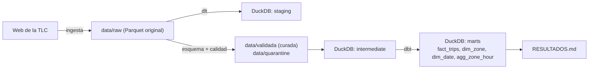

# Pipeline NYC Taxi - Parcial de Fundamentos de Datos

Pipeline batch que descarga los viajes de taxi amarillo de Nueva York de un mes, los valida, separa las filas malas en cuarentena, arma un modelo estrella y responde 6 preguntas de negocio.

El mes que elegimos es marzo 2025, comparado con marzo 2024. Las respuestas están en [`RESULTADOS.md`](RESULTADOS.md).

## Integrantes

| Nombre | Legajo |
|---|---|
| Nicolás Quinteros | 53049 |
| Josué Limo Muñoz | 58000 |

## Cómo correrlo

Hace falta: Python 3.12, Git, Docker Desktop y `make` (en Windows se instala con `winget install ezwinports.make`).

```bash
git clone https://github.com/nicoquinteros23/pipeline-nyc-taxi.git
cd pipeline-nyc-taxi
git switch dev
python -m venv .venv
.venv/Scripts/pip install -r requirements.txt   # en Linux/Mac: .venv/bin/pip
make up                                         # levanta Dagster, Grafana, Prometheus y Dozzle
make all MES=2025-03                            # corre todo el pipeline
make test                                       # corre los tests
```

`make all MES=2025-03` procesa el mes pedido y el mismo mes del año anterior. Funciona con cualquier mes publicado por la TLC, por ejemplo `make all MES=2025-01`.

Servicios que quedan levantados (solo en la máquina local):

| Servicio | Dirección | Para qué |
|---|---|---|
| Dagster | http://127.0.0.1:3000 | ver cada etapa del pipeline y sus logs |
| Grafana | http://127.0.0.1:3001 (admin / admin) | tablero con tiempos, filas y uso de CPU/RAM |
| Prometheus | http://127.0.0.1:9090 | junta las métricas que muestra Grafana |
| Dozzle | http://127.0.0.1:8080 | logs de los contenedores en vivo |

## Arquitectura



La ingesta, el esquema y la calidad están hechos en Python. Como base de datos usamos DuckDB, el modelo estrella se arma con dbt y Dagster se encarga de correr las etapas en orden. Además de lo visto en clase agregamos dlt, Docker, Prometheus, Grafana y Dozzle.

## Qué hace cada parte

### 1. Ingesta (`src/ingesta.py`)

Descarga el Parquet del mes y la tabla de zonas en `data/raw/yellow/year=AAAA/month=MM/`. Antes de descargar compara el hash SHA-256 con el último registrado. Si es el mismo, no lo vuelve a bajar.

Cada intento queda anotado en `data/control/ingestion_log.csv` con archivo, URL, filas, bytes, hash, fecha y estado.

Si falla la red, reintenta 3 veces esperando cada vez el doble (2, 4 y 8 segundos). Si sigue fallando, el proceso termina con código distinto de 0.

### 2. Esquema (`contracts/yellow_schema.yaml`, `src/esquema.py`)

El contrato tiene las 20 columnas esperadas con su tipo. Cada mes se compara contra el contrato: columnas que faltan, columnas nuevas y tipos distintos. Los nombres se pasan a snake_case (por ejemplo, `PULocationID` pasa a ser `pu_location_id`) y los dos meses quedan con el mismo esquema.

La columna `cbd_congestion_fee` existe recién desde enero de 2025, así que en los datos de 2024 no está. Decidimos dejarla en NULL y no en 0, porque poner 0 daría a entender que el cargo existía y no se cobró. Por eso la pregunta 3 se calcula solo con los datos de 2025.

Si aparece una columna nueva que no está en el contrato, se avisa en el reporte de esquema y no se pasa a la capa curada hasta que la agreguemos al contrato. Si falta una columna obligatoria o un tipo no se puede convertir, el pipeline se detiene.

### 3. Calidad (`contracts/quality_rules.yaml`, `src/calidad.py`)

Hay 11 reglas: las 7 que pide el enunciado más 4 propias. Los umbrales salen de mirar los datos (`docs/exploracion.md`).

| Regla | Qué controla | Tipo |
|---|---|---|
| R01 | la subida cae fuera del mes | rechazo |
| R02 | la bajada es anterior o igual a la subida | rechazo |
| R03 | distancia menor o igual a 0 | rechazo |
| R04 | distancia mayor a 100 millas | rechazo |
| R05 | total negativo | rechazo |
| R06 | pasajeros nulo o 0 | advertencia |
| R07 | zona que no existe en la tabla de zonas | rechazo |
| R08 | fila duplicada exacta | rechazo |
| R09 | velocidad mayor a 100 mph (propia) | rechazo |
| R10 | zona 264/265 "desconocida" (propia) | advertencia |
| R11 | total mayor a 1000 USD (propia) | rechazo |

Cómo elegimos los umbrales. Para la distancia máxima pusimos 100 millas: el 99,99 % de los viajes recorre menos de 58 millas y por encima de 100 casi no hay viajes, salvo valores imposibles como 320.136 millas. Para la velocidad usamos 100 mph, porque el 99,9 % de los viajes va a menos de 46 mph y lo que sigue son errores de registro. Para el total máximo usamos 1000 USD: el 99,99 % está por debajo de 326 USD y solo 17 viajes de 2025 lo superan. Cada umbral tiene su justificación en `contracts/quality_rules.yaml`.

Por qué R06 y R10 son advertencias y no rechazos. En R06, los pasajeros nulos coinciden uno a uno con los viajes de `payment_type = 0`, que son el 22 % de marzo 2025. No es un error de carga sino algo propio de ese tipo de viaje, y descartarlos dejaría afuera viajes reales con importes correctos. En R10, las zonas 264 y 265 existen en la tabla de zonas pero no dicen dónde fue el viaje, así que el viaje sirve igual y solo lo marcamos.

Tratamiento de nulos. Una fila con fecha, distancia o importe nulo se rechaza, porque sin esos datos no se puede calcular duración, velocidad ni ingresos. Los nulos de columnas opcionales (como `cbd_congestion_fee` en 2024 o `passenger_count`) se dejan como NULL y no se reemplazan por 0. La propina como porcentaje queda en NULL cuando la tarifa es 0, para no dividir por cero.

Las filas rechazadas van a `data/quarantine/` con la fila original, el archivo de origen, el número de fila y la lista de reglas que violaron. Las advertencias no se descartan: quedan marcadas en la columna `flags`.

Por cada mes se genera `reports/calidad_AAAA-MM.md`. Si `leídas ≠ aceptadas + cuarentena`, el pipeline falla y no toca los datos ya guardados.

En marzo 2025 quedó el 4,58 % en cuarentena (189.964 filas). Lo que más pesó fue R03 (103.722) y R05 (68.686).

Ejemplo de fila en cuarentena: `yellow_tripdata_2025-03.parquet`, fila 1.048.653, viaje del 11/03 de 11:18 a 11:27 con distancia 0.0, rechazada por la regla `R03`.

### 4. Capa curada (`data/validada/`)

Parquet particionado por `year=AAAA/month=M`. Además de las columnas originales, agrega la duración del viaje en minutos, la velocidad media en mph, la fecha, hora y día de la semana de la subida, la propina como porcentaje de la tarifa (solo cuando la tarifa es mayor a 0) y el barrio y la zona de subida y de bajada, que se sacan de la tabla de zonas.

Reprocesar un mes reemplaza solo la partición de ese mes. Primero se escribe en una carpeta temporal y después se cambia por la anterior.

Para demostrarlo reprocesamos solo marzo 2025 con `python -m src.calidad --mes 2025-03` y comparamos las particiones antes y después:

| Partición | Filas antes | Filas después | Archivo modificado |
|---|---:|---:|---|
| `validada/year=2024/month=3` | 3.453.562 | 3.453.562 | no (17:28:21) |
| `quarantine/year=2024/month=3` | 129.066 | 129.066 | no (17:28:21) |
| `validada/year=2025/month=3` | 3.955.293 | 3.955.293 | sí (17:28:31 pasa a 18:13:15) |
| `quarantine/year=2025/month=3` | 189.964 | 189.964 | sí (17:28:31 pasa a 18:13:15) |

Solo se reescribió la partición de 2025-03. La de 2024-03 quedó con el mismo archivo y la misma hora de modificación, y los conteos no cambiaron.

También corrimos `make all MES=2025-03` dos veces seguidas. La segunda vez no se volvió a descargar nada (mismo hash) y los conteos dieron igual: 3.582.628 leídas en 2024-03 y 4.145.257 en 2025-03, con las mismas aceptadas y cuarentena.

### 5. Modelo estrella (`dbt_project/models/marts/`)

| Tabla | Granularidad (qué representa una fila) |
|---|---|
| `fact_trips` | un viaje aceptado |
| `dim_zone` | una zona de la TLC (265) |
| `dim_date` | un día |
| `agg_zone_hour` | una zona de subida en una fecha y hora (viajes, recaudación y duración media) |

Las 6 consultas están en `sql/q1..q6`. `src/preguntas.py` las corre y escribe `RESULTADOS.md` con el número, la consulta y una interpretación de cada una. dbt además corre tests: que no haya ids repetidos y que los totales de `fact_trips` y `agg_zone_hour` coincidan.

## Tests

`make test` corre 47 tests con pytest. Los que pide el enunciado están en `tests/test_calidad.py` (reglas de calidad con datos sintéticos), `tests/test_ingesta.py` (la ingesta no vuelve a descargar si el archivo no cambió) y `tests/test_reconciliacion.py` (un caso donde los conteos cierran y otro donde no).

## Tiempo y memoria

Lo medimos en una notebook con Windows 11, 8 GB de RAM y Docker abierto. La primera corrida, que incluye la descarga y la carga con dlt, tarda unos 2 minutos. Las siguientes tardan unos 50 segundos porque no vuelven a descargar. El pico de RAM del pipeline fue de 1,54 GB, ya que DuckDB trabaja con un límite de memoria y usa disco temporal cuando lo necesita.

## Limitaciones

- Corre un solo pipeline a la vez. Hay un archivo de bloqueo en `data/tmp/` que lo controla.
- Depende de que la TLC tenga publicado el mes pedido y de que respete el contrato de columnas.
- Las interpretaciones de `RESULTADOS.md` están escritas para marzo. Con otro mes se generan los números, pero la interpretación queda pendiente.
- La partición se llama `month=3`, sin el cero adelante.
- En marzo 2025 el proveedor `VendorID = 7` (21.481 viajes) tiene la bajada igual a la subida, así que cae en cuarentena por R02.

## Uso de IA

Usamos Claude y Codex. Más que nada los usamos para entender cómo se configuraban dlt, dbt y Dagster, que eran nuevos para nosotros, y para destrabar errores cuando algo no corría (sobre todo con Docker en Windows). También nos ayudaron a armar partes del código, que después probamos y ajustamos.

Las decisiones del trabajo las tomamos nosotros: elegimos marzo, definimos qué viajes se consideran inválidos mirando los datos (por ejemplo, desde qué distancia o velocidad un viaje no tiene sentido), decidimos dejar `cbd_congestion_fee` en NULL para 2024 y escribimos las interpretaciones de los resultados.
