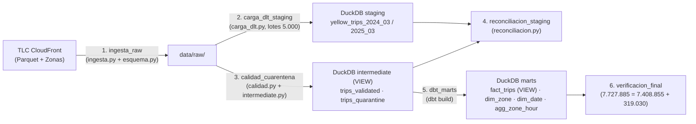
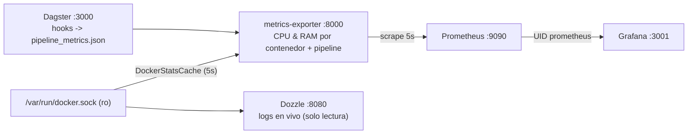

# Pipeline Batch NYC Taxi — Arquitectura Simplificada

Plataforma reproducible de ingeniería de datos para ingerir, validar, limpiar y modelar los viajes de taxi amarillo de Nueva York (**2024-03** y **2025-03**, junto con el catálogo oficial de **265 zonas** de la NYC TLC), bajo una **única arquitectura oficial** orquestada por Dagster sobre `data/warehouse/nyc_taxi_dlt.duckdb`, con transformaciones en `dbt` y observabilidad real por contenedor Docker en Prometheus, Grafana y Dozzle.

Ver también el resumen técnico en [`docs/ARQUITECTURA_FINAL.md`](docs/ARQUITECTURA_FINAL.md) y los resultados analíticos en [`RESULTADOS.md`](RESULTADOS.md).

---

## 1. Arquitectura definitiva y flujo único oficial





### Responsabilidad única por herramienta

| Herramienta | Propiedad en el sistema |
|---|---|
| **Python 3.12 + PyArrow** | Descarga streaming SHA-256, validación de contrato YAML, streaming por lotes y exporter HTTP. |
| **dlt 1.32.0** | Ingesta idempotente por lotes Arrow de 5.000 filas hacia el esquema `staging` de DuckDB. |
| **DuckDB 1.5.6** | Motor analítico columnar único (`data/warehouse/nyc_taxi_dlt.duckdb`) con `memory_limit='1.5GB'`, `threads=2` y volcado a disco (`data/tmp/duckdb`). |
| **Calidad (`src/calidad.py`)** | Evaluación SQL de las 11 reglas de `contracts/quality_rules.yaml`, aislamiento de rechazos en cuarentena y marcas `flags` para advertencias. |
| **dbt 1.12 / dbt-duckdb** | Capas `dbt_staging` → `intermediate` → `marts` (`fact_trips` como `VIEW`, `dim_zone`, `dim_date`, `agg_zone_hour`) y 50 pruebas automatizadas. |
| **Dagster 1.13** | Único orquestador oficial (`orchestration/`): 6 *Software-Defined Assets* en serie, prevención de ejecuciones simultáneas y hooks hacia métricas. |
| **Docker & Compose** | Empaquetado y red local de los 5 servicios esenciales con puertos acotados a `127.0.0.1`. |
| **Prometheus + Exporter** | Recolección cada `5 s` de métricas de negocio del pipeline y consumo real individual de CPU/RAM por contenedor Docker. |
| **Grafana** | Dashboard provisionado `NYC Taxi — Pipeline Monitoring` con 12 paneles (estado, reconciliación, CPU y RAM por contenedor y duración por etapa). |
| **Dozzle** | Visor web de logs en tiempo real conectado al socket Docker en modo solo lectura (`DOZZLE_ENABLE_ACTIONS=false`). |

---

## 2. Datos y cifras de referencia

- **Fuentes (`data/raw/`):** `yellow_tripdata_2024-03.parquet` (`3.582.628` filas), `yellow_tripdata_2025-03.parquet` (`4.145.257` filas) y `taxi_zone_lookup.csv` (`265` zonas).
- **Reconciliación exacta (`python -m src.reconciliacion --con-marts`):**

| Período | `staging` (`dlt`) | `aceptadas` (`intermediate`) | `cuarentena` (`intermediate`) | Diferencia |
|---|---:|---:|---:|---:|
| `2024-03` | 3.582.628 | 3.453.562 | 129.066 | 0 |
| `2025-03` | 4.145.257 | 3.955.293 | 189.964 | 0 |
| **TOTAL** | **7.727.885** | **7.408.855** | **319.030** | **0** |

- **Marts (`nyc_taxi_dlt.duckdb`):** `marts.fact_trips` (`7.408.855`, `VIEW`), `marts.dim_zone` (`265`, `TABLE`), `marts.dim_date` (`396`, `TABLE`), `marts.agg_zone_hour` (`205.179`, `TABLE`, suma de viajes `7.408.855` y revenue `203.263.790,71 USD`).

---

## 3. Instalación y arranque con Docker Compose

Requisitos: Python 3.12, Git, Docker Desktop y ~2,5–3 GB libres para datos/imágenes.

```powershell
# 1. Clonar y crear entorno virtual local
git clone https://github.com/nicoquinteros23/pipeline-nyc-taxi.git
cd pipeline-nyc-taxi
python -m venv .venv
.\.venv\Scripts\Activate.ps1
pip install -r requirements.txt

# 2. Construir imagen (solo la primera vez) e iniciar los 5 servicios Docker
docker compose build
docker compose up -d dagster-webserver metrics-exporter prometheus grafana dozzle

# 3. Verificar que todos estén healthy
docker compose ps
```

*(Con `make` disponible: `make install`, `make up`, `make ps`, `make down`).*

### Puertos locales verificados (solo `127.0.0.1`)

| Servicio | Contenedor | URL local | Credenciales / Notas |
|---|---|---|---|
| Dagster UI | `nyc-taxi-dagster` | `http://127.0.0.1:3000` | Job `nyc_taxi_pipeline` (6 assets) |
| Metrics Exporter | `nyc-taxi-exporter` | `http://127.0.0.1:8000/metrics` | Salud en `/health` |
| Prometheus | `nyc-taxi-prometheus` | `http://127.0.0.1:9090` | Targets `prometheus` y `nyc_taxi_exporter` |
| Grafana | `nyc-taxi-grafana` | `http://127.0.0.1:3001` | `admin` / `admin` (`GRAFANA_ADMIN_*`) |
| Dozzle | `nyc-taxi-dozzle` | `http://127.0.0.1:8080` | Solo lectura (`/var/run/docker.sock:ro`) |

---

## 4. Cómo ejecutar el pipeline y verificar resultados

1. **Desde Dagster UI (`http://127.0.0.1:3000`):** ir a **Jobs → `nyc_taxi_pipeline` → Launchpad** y presionar **Launch Run**.
   - Parámetros (`TaxiPipelineConfig`): `mes: "2025-03"`, `mes_comparacion: ""` (calcula `"2024-03"`), `sin_ingesta: true` (usa raw locales si ya fueron descargados; poner `false` para descargar), `forzar_dlt: false`, `simular_fallo: false`.
2. **Desde terminal invocando el mismo job Dagster:**
   ```powershell
   make dagster-run MES=2025-03
   ```
3. **Verificar datos, dbt y consultas analíticas:**
   ```powershell
   .\.venv\Scripts\python.exe -m src.reconciliacion --con-marts
   .\.venv\Scripts\dbt.exe build --project-dir dbt_project --profiles-dir dbt_project
   .\.venv\Scripts\python.exe -m src.preguntas --mes 2025-03 --mes-comparacion 2024-03
   ```
4. **Ejecutar tests automatizados:**
   ```powershell
   .\.venv\Scripts\python.exe -m pytest -v
   ```
5. **Detener los servicios (conservando datos y volúmenes):**
   ```powershell
   docker compose down
   ```

---

## 5. Observabilidad: Grafana, Prometheus y Dozzle

- **Grafana (`http://127.0.0.1:3001`, usuario `admin` / clave `admin`):** abrir **Dashboards → NYC Taxi → `NYC Taxi — Pipeline Monitoring`**.
- **Cómo interpretar CPU y RAM por contenedor:**
  - `metrics-exporter` consulta `/var/run/docker.sock` (`DockerStatsCache`, cada `5 s`) para cada servicio Compose del proyecto.
  - **CPU (`nyc_taxi_container_cpu_percent`):** calculado mediante delta de `cpu_stats` / `system_cpu_usage × online_cpus × 100`. Un valor de `100 %` equivale a 1 núcleo lógico saturado (en un host de 8 núcleos lógicos puede superar `100 %` si un contenedor utiliza varios núcleos).
  - **RAM (`nyc_taxi_container_memory_usage_bytes`):** reporta `memory_stats.usage - inactive_file` en bytes (equivalente a `docker stats`, mostrado en MiB por Grafana), diferenciando la memoria asignada de cada contenedor del consumo global del host.
- **Prometheus (`http://127.0.0.1:9090`):** verificar **Status → Targets** (`prometheus` y `nyc_taxi_exporter` en `UP`). Ejemplos PromQL: `nyc_taxi_container_cpu_percent`, `nyc_taxi_container_memory_usage_bytes`, `nyc_taxi_container_running`, `nyc_taxi_reconciliation_diff_rows`, `nyc_taxi_pipeline_stage_duration_seconds`.
- **Dozzle (`http://127.0.0.1:8080`):** seleccionar **`nyc-taxi-dagster`** para seguir en vivo los logs de cada asset del pipeline, `dlt` y `dbt build`.

---

## 6. Estructura del repositorio

```text
contracts/          yellow_schema.yaml (20 columnas) y quality_rules.yaml (R01–R11)
src/                ingesta.py, esquema.py, carga_dlt.py, calidad.py, intermediate.py,
                    reconciliacion.py, preguntas.py, metrics_exporter.py
orchestration/      definitions.py, assets.py (6 assets), jobs.py, resources.py, dagster.yaml
dbt_project/        dbt_project.yml, profiles.yml, macros/, models/{staging,intermediate,marts}, tests/
monitoring/         prometheus/prometheus.yml y grafana/{provisioning,dashboards/nyc_taxi_monitoring.json}
sql/                q1_top_zonas.sql .. q6_variacion.sql
tests/              Suite pytest (ingesta, esquema, calidad, reconciliación, dlt, intermediate, preguntas, Dagster, Docker exporter)
docs/               ARQUITECTURA_FINAL.md, exploracion.md, interpretaciones.yaml
Dockerfile          docker-compose.yml  Makefile  requirements.txt  RESULTADOS.md
```

---

## 7. Seguridad, concurrencia y limitaciones conocidas

- **Concurrencia:** solo puede correr **una ejecución pesada a la vez**. `orchestration/resources.py` verifica ejecuciones `STARTING`/`STARTED` en Dagster (`verificar_sin_otra_ejecucion_activa`) y todas las etapas de escritura comparten `FileLock("data/tmp/pipeline_duckdb.lock")` (`in_process_executor` + `DefaultRunCoordinator`).
- **Seguridad Docker:** todos los puertos escuchan en `127.0.0.1`. `/var/run/docker.sock` se monta en `:ro` únicamente en `metrics-exporter` y `dozzle` (`DOZZLE_ENABLE_ACTIONS=false`). El montaje `:ro` impide escribir en el descriptor del archivo socket, aunque en un daemon Docker local la API Unix sigue aceptando solicitudes `GET` de inspección mientras el contenedor esté en esa red local de desarrollo.
- **Períodos soportados:** la configuración actual unifica y valida explícitamente `2024-03` y `2025-03` contra las fuentes y modelos `dbt_staging` declarados en `dbt_project/`. Cualquier período no soportado falla con error explícito en lugar de producir marts desactualizados.
- **Datos heredados y hardware:** `data/warehouse/taxi.duckdb` se conserva intacta en disco sin dependencias activas; en equipos con 8 GB de RAM y disco acotado (`~2,6 GB` libres), no ejecutar CLI y Dagster simultáneamente. En el análisis de negocio, `VendorID = 7` (21.481 filas en 2025-03) queda en cuarentena por `R02` (`bajada <= subida`) y `passenger_count = NULL` coincide 1:1 con `payment_type = 0` (`R06` marcada como advertencia).
