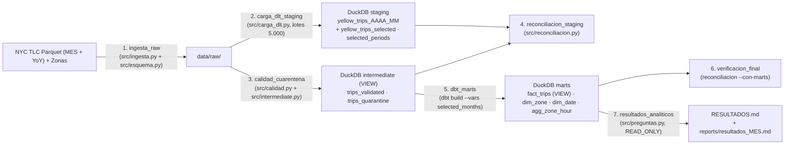
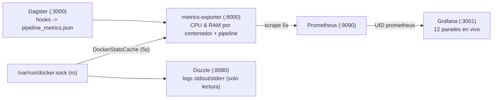

# Arquitectura Final Simplificada y Dinámica — `pipeline-nyc-taxi`

## 1. Principio rector: una sola responsabilidad por componente

La plataforma conserva exclusivamente un flujo oficial de ingeniería de datos sobre **`data/warehouse/nyc_taxi_dlt.duckdb`**, parametrizado dinámicamente por **`MES=AAAA-MM`** (con cálculo automático del período de comparación **`(AAAA-1)-MM`**), evitando duplicar orquestadores, código específico por mes o servicios prescindibles.

## 2. Propiedad clara de cada capa y módulo

| Componente | Responsabilidad única | Archivos clave |
|---|---|---|
| **Entrada única y CLI** | `make all MES=AAAA-MM` delega directamente en el adaptador delgado hacia Dagster | [Makefile](file:///c:/Users/albar/OneDrive/Documentos/pipeline-nyc-taxi/Makefile), [cli.py](file:///c:/Users/albar/OneDrive/Documentos/pipeline-nyc-taxi/orchestration/cli.py) |
| **Orquestación** | Único flujo oficial de **7 assets** en serie (`ingesta_raw` → `resultados_analiticos`), locks `pipeline_run.lock` / `pipeline_duckdb.lock` y prevención de ejecuciones simultáneas | [definitions.py](file:///c:/Users/albar/OneDrive/Documentos/pipeline-nyc-taxi/orchestration/definitions.py), [assets.py](file:///c:/Users/albar/OneDrive/Documentos/pipeline-nyc-taxi/orchestration/assets.py), [jobs.py](file:///c:/Users/albar/OneDrive/Documentos/pipeline-nyc-taxi/orchestration/jobs.py), [resources.py](file:///c:/Users/albar/OneDrive/Documentos/pipeline-nyc-taxi/orchestration/resources.py), [dagster.yaml](file:///c:/Users/albar/OneDrive/Documentos/pipeline-nyc-taxi/orchestration/dagster.yaml) |
| **Ingesta y Esquema** | Descarga streaming SHA-256 idempotente y validación de contrato por mes | [ingesta.py](file:///c:/Users/albar/OneDrive/Documentos/pipeline-nyc-taxi/src/ingesta.py), [esquema.py](file:///c:/Users/albar/OneDrive/Documentos/pipeline-nyc-taxi/src/esquema.py) |
| **Carga dlt (`staging`)** | Carga incremental en `staging.yellow_trips_AAAA_MM` (conserva histórico) + actualización atómica de `staging.yellow_trips_selected` y `staging.selected_periods` completando columnas opcionales con `NULL` | [carga_dlt.py](file:///c:/Users/albar/OneDrive/Documentos/pipeline-nyc-taxi/src/carga_dlt.py) |
| **Calidad e `intermediate`** | Evaluación SQL de 11 reglas (`R01`–`R11`), cuarentena y vistas transaccionales POSIX (`BEGIN/COMMIT` con prevalidación) | [calidad.py](file:///c:/Users/albar/OneDrive/Documentos/pipeline-nyc-taxi/src/calidad.py), [intermediate.py](file:///c:/Users/albar/OneDrive/Documentos/pipeline-nyc-taxi/src/intermediate.py) |
| **Reconciliación y Negocio** | Cierre `staging = aceptadas + cuarentena` + consistencia de períodos en `marts` y ejecución de `sql/q1..q6` parametrizados | [reconciliacion.py](file:///c:/Users/albar/OneDrive/Documentos/pipeline-nyc-taxi/src/reconciliacion.py), [preguntas.py](file:///c:/Users/albar/OneDrive/Documentos/pipeline-nyc-taxi/src/preguntas.py) |
| **Modelado analítico (dbt)** | Capas dinámicas `dbt_staging` → `intermediate` → `marts` sin modelos hardcodeados de marzo (`57` nodos en `dbt build`: `8` modelos + `49` tests incluyendo `assert_selected_periods_match`) | [dbt_project.yml](file:///c:/Users/albar/OneDrive/Documentos/pipeline-nyc-taxi/dbt_project/dbt_project.yml), [profiles.yml](file:///c:/Users/albar/OneDrive/Documentos/pipeline-nyc-taxi/dbt_project/profiles.yml) |
| **Observabilidad** | Métricas de pipeline + CPU/RAM reales por contenedor Docker, Prometheus, Grafana y Dozzle | [metrics_exporter.py](file:///c:/Users/albar/OneDrive/Documentos/pipeline-nyc-taxi/src/metrics_exporter.py), [prometheus.yml](file:///c:/Users/albar/OneDrive/Documentos/pipeline-nyc-taxi/monitoring/prometheus/prometheus.yml), [nyc_taxi_monitoring.json](file:///c:/Users/albar/OneDrive/Documentos/pipeline-nyc-taxi/monitoring/grafana/dashboards/nyc_taxi_monitoring.json) |

## 3. Monitoreo real por contenedor y seguridad

- En lugar de cAdvisor (que presenta limitaciones con cgroups en Docker Desktop sobre Windows), [metrics_exporter.py](file:///c:/Users/albar/OneDrive/Documentos/pipeline-nyc-taxi/src/metrics_exporter.py) consulta el socket Unix `/var/run/docker.sock` mediante `DockerStatsCache` y expone por cada servicio Compose (`dagster-webserver`, `metrics-exporter`, `prometheus`, `grafana`, `dozzle`):
  - `nyc_taxi_container_cpu_percent{container, service}` (% de núcleo lógico según delta de Docker API `cpu_stats`/`precpu_stats`).
  - `nyc_taxi_container_memory_usage_bytes{container, service}` (memoria real sin caché inactiva).
  - `nyc_taxi_container_running{container, service}` (`1` activo / `0` detenido).
- **Seguridad del socket Docker:** se monta en `:ro` únicamente en `metrics-exporter` y `dozzle` (con `DOZZLE_ENABLE_ACTIONS=false`), sin exponer Docker por TCP y limitando todos los puertos a `127.0.0.1`.

## 4. Guía breve para la defensa oral

- **¿Cómo cambia el mes sin tocar código?** `make all MES=2025-01` pasa el período a `orchestration/cli.py`, que calcula `mes_comparacion="2024-01"` y ejecuta los 7 assets de Dagster: descarga los Parquet si faltan, consolida `staging.yellow_trips_selected` y `staging.selected_periods`, filtra las vistas `intermediate`, compila los modelos dinámicos en `dbt` (`var('selected_months')`) y genera `RESULTADOS.md` + `reports/resultados_2025-01.md`.
- **¿Por qué dlt + vista seleccionada?** `dlt` carga cada mes en su tabla histórica `staging.yellow_trips_AAAA_MM` (sin perder corridas anteriores) y `actualizar_staging_seleccionado` proyecta el contrato YAML normalizado (completando `cbd_congestion_fee` con `NULL` cuando falta en 2024) en `staging.yellow_trips_selected` para `dbt`.
- **¿Por qué DuckDB?** Motor columnar OLAP embebido con volcado a disco (`memory_limit` acotado, `threads=2`, `data/tmp/duckdb`), adecuado para procesar >7M filas en un equipo de 8 GB RAM sin levantar servidores SQL externos.
- **¿Por qué Dagster + Prometheus + Grafana + Dozzle?** Dagster provee el DAG único de 7 assets, UI GraphQL, bloqueo de concurrencia y hooks de métricas; Prometheus y Grafana muestran salud del pipeline y CPU/RAM reales por contenedor en 12 paneles; Dozzle muestra logs en tiempo real en solo lectura.
- **¿Cómo se comprueba end-to-end?** Con `pytest` (`46/46`), `dbt build` (`57/57`), conmutación real verificada `2025-03` (`7.727.885 = 7.408.855 + 319.030`, revenue `203.263.790,71 USD`) → `2025-01` (`6.439.850 = 6.194.492 + 245.358`, revenue `165.896.143,17 USD`) → `2025-03`, y ejecución/observabilidad viva en Docker.
