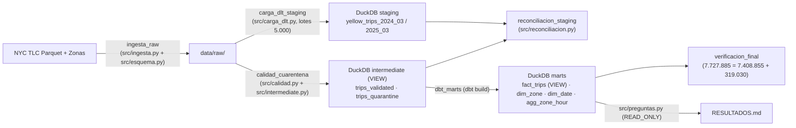
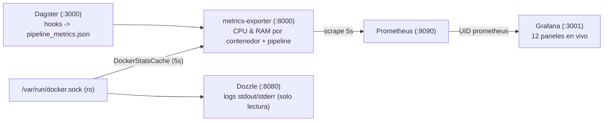

# Arquitectura Final Simplificada — `pipeline-nyc-taxi`

## 1. Principio rector: una sola responsabilidad por componente

La plataforma conserva exclusivamente un flujo oficial de ingeniería de datos sobre **`data/warehouse/nyc_taxi_dlt.duckdb`**, eliminando orquestadores paralelos, modelos estrella heredados y servicios prescindibles.

## 2. Propiedad clara de cada capa y módulo

| Componente | Responsabilidad única | Archivos clave |
|---|---|---|
| **Orquestación** | Único flujo oficial de **6 assets** en serie (`ingesta_raw` → `verificacion_final`), bloqueo DuckDB y prevención de ejecuciones simultáneas | [definitions.py](file:///c:/Users/albar/OneDrive/Documentos/pipeline-nyc-taxi/orchestration/definitions.py), [assets.py](file:///c:/Users/albar/OneDrive/Documentos/pipeline-nyc-taxi/orchestration/assets.py), [jobs.py](file:///c:/Users/albar/OneDrive/Documentos/pipeline-nyc-taxi/orchestration/jobs.py), [resources.py](file:///c:/Users/albar/OneDrive/Documentos/pipeline-nyc-taxi/orchestration/resources.py), [dagster.yaml](file:///c:/Users/albar/OneDrive/Documentos/pipeline-nyc-taxi/orchestration/dagster.yaml) |
| **Ingesta y Esquema** | Descarga streaming SHA-256 idempotente y validación contra `contracts/yellow_schema.yaml` | [ingesta.py](file:///c:/Users/albar/OneDrive/Documentos/pipeline-nyc-taxi/src/ingesta.py), [esquema.py](file:///c:/Users/albar/OneDrive/Documentos/pipeline-nyc-taxi/src/esquema.py) |
| **Carga dlt (`staging`)** | Carga por lotes Arrow de 5.000 filas hacia `staging.yellow_trips_*` | [carga_dlt.py](file:///c:/Users/albar/OneDrive/Documentos/pipeline-nyc-taxi/src/carga_dlt.py) |
| **Calidad e `intermediate`** | Evaluación SQL de 11 reglas (`R01`–`R11`), cuarentena y vistas POSIX portables | [calidad.py](file:///c:/Users/albar/OneDrive/Documentos/pipeline-nyc-taxi/src/calidad.py), [intermediate.py](file:///c:/Users/albar/OneDrive/Documentos/pipeline-nyc-taxi/src/intermediate.py) |
| **Reconciliación y Negocio** | Cierre `staging = aceptadas + cuarentena` y ejecución de `sql/q1..q6` en `READ_ONLY` | [reconciliacion.py](file:///c:/Users/albar/OneDrive/Documentos/pipeline-nyc-taxi/src/reconciliacion.py), [preguntas.py](file:///c:/Users/albar/OneDrive/Documentos/pipeline-nyc-taxi/src/preguntas.py) |
| **Modelado analítico (dbt)** | Capas `dbt_staging` → `intermediate` → `marts` y 50 tests (`60/60` en `dbt build`) | [dbt_project.yml](file:///c:/Users/albar/OneDrive/Documentos/pipeline-nyc-taxi/dbt_project/dbt_project.yml), [profiles.yml](file:///c:/Users/albar/OneDrive/Documentos/pipeline-nyc-taxi/dbt_project/profiles.yml) |
| **Observabilidad** | Métricas de pipeline + CPU/RAM reales por contenedor Docker, Prometheus, Grafana y Dozzle | [metrics_exporter.py](file:///c:/Users/albar/OneDrive/Documentos/pipeline-nyc-taxi/src/metrics_exporter.py), [prometheus.yml](file:///c:/Users/albar/OneDrive/Documentos/pipeline-nyc-taxi/monitoring/prometheus/prometheus.yml), [nyc_taxi_monitoring.json](file:///c:/Users/albar/OneDrive/Documentos/pipeline-nyc-taxi/monitoring/grafana/dashboards/nyc_taxi_monitoring.json) |

## 3. Monitoreo real por contenedor y seguridad

- En lugar de cAdvisor (que presenta limitaciones con cgroups en Docker Desktop sobre Windows), [metrics_exporter.py](file:///c:/Users/albar/OneDrive/Documentos/pipeline-nyc-taxi/src/metrics_exporter.py) consulta el socket Unix `/var/run/docker.sock` mediante `DockerStatsCache` y expone por cada servicio Compose (`dagster-webserver`, `metrics-exporter`, `prometheus`, `grafana`, `dozzle`):
  - `nyc_taxi_container_cpu_percent{container, service}` (% de núcleo lógico según delta de Docker API `cpu_stats`/`precpu_stats`).
  - `nyc_taxi_container_memory_usage_bytes{container, service}` (memoria real sin caché inactiva).
  - `nyc_taxi_container_running{container, service}` (`1` activo / `0` detenido).
- **Seguridad del socket Docker:** se monta en `:ro` únicamente en `metrics-exporter` y `dozzle` (con `DOZZLE_ENABLE_ACTIONS=false`), sin exponer Docker por TCP y limitando todos los puertos a `127.0.0.1`. *Riesgo residual:* cualquier lectura directa del socket dentro de la VM Linux comparte acceso de solo consulta al daemon Docker local.

## 4. Guía breve para la defensa oral

- **¿Por qué dlt?** Automatiza y controla la carga idempotente por lotes hacia `staging` de DuckDB sin agotar los 8 GB de RAM.
- **¿Por qué DuckDB?** Motor columnar OLAP embebido que lee Parquet directamente desde SQL con volcado a disco (`memory_limit='1.5GB'`, `threads=2`), sin requerir un servidor Postgres adicional.
- **¿Por qué dbt?** Estandariza en SQL versionado las capas `dbt_staging` → `intermediate` → `marts`, evita duplicar 7,4 millones de filas usando vistas en `fact_trips` y aporta 50 tests automáticos.
- **¿Por qué Dagster?** Actúa como único orquestador oficial mediante 6 Software-Defined Assets con dependencias claras, prevención de ejecuciones simultáneas y hooks hacia observabilidad.
- **¿Por qué Prometheus?** Recolecta en serie temporal métricas reales de negocio (reconciliación, duración por etapa) y consumo individual por contenedor Docker cada `5 s`.
- **¿Por qué Grafana?** Visualiza de inmediato el estado de servicios, recursos reales por contenedor (CPU y RAM) y salud del pipeline en 12 paneles provisionados.
- **¿Por qué Dozzle?** Centraliza en tiempo real los logs `stdout`/`stderr` de los 5 contenedores en modo solo lectura.
- **¿Qué es `staging` / `intermediate` / `marts`?** `staging`: datos cargados por `dlt` fieles al origen; `intermediate`: vistas portables sobre aceptadas/cuarentena y enriquecimiento de columnas/zonas; `marts`: modelo estrella final (`fact_trips`, `dim_zone`, `dim_date`, `agg_zone_hour`).
- **¿Cómo se comprueba que el pipeline funciona?** Con `pytest`, `dbt build` (`60/60`), `python -m src.reconciliacion --con-marts` (`7.727.885 = 7.408.855 + 319.030`, `revenue = 203.263.790,71 USD`), y observando corridas reales en Dagster, Prometheus, Grafana y Dozzle.
