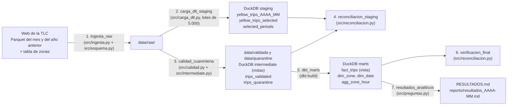
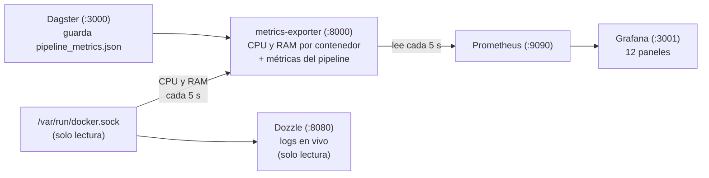

# Arquitectura del pipeline

En el README está el resumen. Acá explicamos con más detalle cómo está armado el pipeline, qué hace cada etapa y por qué elegimos cada herramienta.

## Idea general

Todo el pipeline se corre con un solo comando, `make all MES=AAAA-MM`. A partir del mes que se le pasa, calcula solo el mismo mes del año anterior (por ejemplo, con `MES=2025-03` procesa 2025-03 y 2024-03). No hay nada escrito a mano para un mes en particular, así que para cambiar de mes no hace falta tocar código.

Los datos se guardan en archivos Parquet dentro de `data/` y en una base DuckDB (`data/warehouse/nyc_taxi_dlt.duckdb`). Dagster se encarga de correr las etapas en orden y de cortar si alguna falla.

## Las 7 etapas

Cada etapa es un asset de Dagster definido en `orchestration/assets.py`.

1. `ingesta_raw` (`src/ingesta.py`, `src/esquema.py`). Descarga los dos Parquet del mes y la tabla de zonas. Antes de descargar calcula el hash SHA-256 y lo compara con el último del log (`data/control/ingestion_log.csv`). Si coincide, no vuelve a bajar el archivo. Después controla el esquema contra el contrato `contracts/yellow_schema.yaml`.

2. `carga_dlt_staging` (`src/carga_dlt.py`). Con dlt carga cada mes en su propia tabla de staging (`staging.yellow_trips_2025_03`, por ejemplo), leyendo el Parquet de a 5.000 filas para no llenar la memoria. Las tablas de meses anteriores no se borran. Además arma `staging.yellow_trips_selected` con los dos meses que se están procesando y con los nombres de columnas ya unificados. Ahí es donde `cbd_congestion_fee` queda en NULL para 2024.

3. `calidad_cuarentena` (`src/calidad.py`, `src/intermediate.py`). Aplica las 11 reglas de `contracts/quality_rules.yaml` con una sola consulta SQL. Las filas que pasan se escriben en `data/validada/` con las columnas derivadas y los nombres de zona, y las que no, en `data/quarantine/` junto con las reglas que violaron. Después crea en DuckDB las vistas `intermediate.trips_validated` e `intermediate.trips_quarantine`, que leen esos Parquet sin copiarlos.

4. `reconciliacion_staging` (`src/reconciliacion.py`). Controla que las filas de staging sean iguales a aceptadas más cuarentena, mes por mes. Si no cierra, el pipeline se detiene.

5. `dbt_marts` (`dbt_project/`). Corre `dbt build`, que crea el modelo estrella y ejecuta los tests de dbt. Los modelos van en tres capas: `dbt_staging`, `intermediate` y `marts`. El mes a procesar le llega a dbt como variable, así que los modelos sirven para cualquier mes.

6. `verificacion_final` (`src/reconciliacion.py`). Vuelve a controlar los conteos, ahora incluyendo los marts: que `fact_trips` tenga la misma cantidad de viajes que la cuarentena dejó pasar y que el total de `agg_zone_hour` coincida con el de `fact_trips`.

7. `resultados_analiticos` (`src/preguntas.py`). Ejecuta las consultas `sql/q1` a `sql/q6` y escribe `RESULTADOS.md`, además de una copia en `reports/resultados_AAAA-MM.md`.

## Modelo estrella

| Tabla | Tipo en DuckDB | Una fila es |
|---|---|---|
| `fact_trips` | vista | un viaje aceptado |
| `dim_zone` | tabla | una de las 265 zonas |
| `dim_date` | tabla | un día del período procesado |
| `agg_zone_hour` | tabla | una zona de subida en una fecha y una hora |

`fact_trips` quedó como vista porque son más de 7 millones de filas y ya están guardadas en Parquet, y materializarla duplicaría los datos. `agg_zone_hour` sí es tabla porque es chica y se consulta seguido.

## Por qué cada herramienta

- DuckDB: procesa millones de filas en una notebook sin tener que levantar un servidor de base de datos. Le pusimos un límite de memoria en cada etapa (entre 256 MB y 1,5 GB) y una carpeta de disco temporal, así que con 8 GB de RAM alcanza.
- dlt: lo usamos para la carga a staging porque ya resuelve la carga por lotes y guarda el estado de cada carga. Si una tabla ya tiene las mismas filas, la saltea.
- dbt: para que las transformaciones del modelo estrella sean archivos SQL con tests, y no consultas sueltas dentro del código Python.
- Dagster: corre las etapas en orden, muestra en una página web cuál falló y cuánto tardó cada una y guarda el historial de corridas. `make all` también pasa por Dagster, así que las corridas desde la terminal aparecen en la interfaz.

## Monitoreo

Al terminar cada corrida, Dagster guarda las métricas en `reports/pipeline_metrics.json`: duración de cada etapa, filas por mes, pico de RAM y si la reconciliación cerró. El `metrics-exporter` (`src/metrics_exporter.py`) lee ese archivo y también le pregunta a Docker cuánta CPU y RAM está usando cada contenedor. Prometheus junta esos datos cada 5 segundos y Grafana los muestra en el tablero "NYC Taxi - Pipeline Monitoring", que tiene paneles de estado de la última corrida, duración por etapa, filas por mes, diferencia de reconciliación y CPU/RAM por contenedor. Dozzle sirve para ver los logs de los contenedores en vivo.

No usamos cAdvisor para medir los contenedores porque en Docker Desktop sobre Windows no da bien los valores. Por eso el exporter le consulta directamente a Docker.

## Seguridad y ejecuciones simultáneas

Todos los servicios escuchan solo en `127.0.0.1`, así que no se pueden abrir desde otra máquina de la red. El exporter y Dozzle necesitan leer el estado de Docker, pero lo tienen montado en modo solo lectura, y a Dozzle le desactivamos las acciones (no puede frenar ni reiniciar contenedores).

DuckDB no permite que dos procesos escriban la misma base al mismo tiempo. Por eso `orchestration/resources.py` usa un archivo de bloqueo en `data/tmp/`: si se lanza una segunda corrida mientras otra está en marcha, espera o termina con error, pero no pisa los datos.

## Cómo lo verificamos

- `make test` corre 47 tests de pytest.
- `dbt build` corre 57 nodos (modelos y tests de dbt) sin errores.
- Corrimos marzo 2025, después enero 2025 y de nuevo marzo, y los conteos de marzo dieron igual las dos veces: 7.727.885 filas leídas = 7.408.855 aceptadas + 319.030 en cuarentena.
